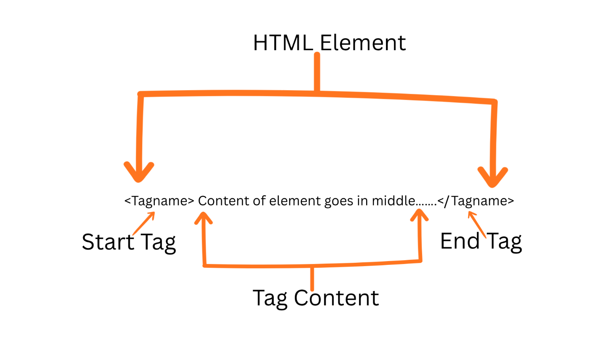

# 1 · Elements 🧩

> **TL;DR:** An HTML element is a piece of content wrapped in tags that tell the browser what it is. Every page is a nested pile of them.

## 💡 The big idea

Think of **LEGO bricks**. Each brick has a shape and purpose: a heading brick, a paragraph brick, a link brick, an image brick. A web page is just bricks snapped together. Tags are the *labels* on the bricks.

## 🔍 The details

### Anatomy of an element

HTML elements are the building blocks written between **tags**, such as `<h1>` for headings, `<p>` for paragraphs, `<a>` for hyperlinks and `` for images.



```html
<p>Hello, world!</p>
```

| Part | In the example | What it is |
|---|---|---|
| Start (opening) tag | `<p>` | Says "a paragraph begins here" |
| Content | `Hello, world!` | What the element contains |
| End (closing) tag | `</p>` | Says "the paragraph ends here" (note the `/`) |

Together, all three parts are **the element**.

### The skeleton every page shares

Every HTML page follows the same skeleton:

- `<!DOCTYPE html>` is a **declaration** that tells the browser to render the page using **modern HTML standards**. (Without it, browsers may switch to an old "quirks mode".)
- `<html>` wraps **everything** else.
- Inside it, `<head>` holds information **about** the page (its title, character encoding, links to stylesheets) that is **not displayed**.
- `<body>` holds the **content that appears** in the browser window.

Think of a book: the `<head>` is the cover page and library card (title, language, publisher), and the `<body>` is the actual pages you read.

### Example page

```html
<!DOCTYPE html>
<html lang="en">
  <head>
    <meta charset="UTF-8">
    <title>Event Registration webpage example</title>
  </head>
  <body>
    <h1>Event Registration</h1>
    <p>Register for our upcoming event.</p>
  </body>
</html>
```

Two small lines with big jobs:

- `lang="en"` tells **browsers, translation tools and screen readers** which language the page is written in. (A screen reader uses it to pick the right pronunciation.)
- `<meta charset="UTF-8">` makes sure **special characters** (accents, Arabic or Chinese text, emoji) display correctly. Forget it and you may see gibberish like `é` instead of `é`.

### Common elements

| Element | Purpose | Friendly note |
|---|---|---|
| `<h1>`–`<h6>` | Headings | `h1` is the most important (like a book title), `h6` the least |
| `<p>` | Paragraph | A block of text |
| `<a>` | Link | The "a" stands for *anchor* |
| `` | Image | Has no closing tag |
| `<ul>` / `<ol>` | Lists | *Unordered* (bullets) / *Ordered* (numbers) |
| `<li>` | List item | Lives inside `ul` or `ol` |
| `<div>` | Generic container | A plain box with no meaning of its own |
| `<form>` | Form | Collects user input ([Lesson 5](05-forms.md)) |
| `<input>` | User input | Text boxes, checkboxes, etc. |
| `<button>` | Button | Something to click |
| `<span>` | Inline container | A plain, invisible wrapper inside a line of text |
| `<label>` | Input label | The caption for a form control |
| `<table>` | Tabular data | Rows and columns ([Lesson 6](06-tables-and-media.md)) |
| `<br>` | Line break | Has no closing tag |

### Two things to know about elements

#### 1️⃣ Void elements

**Void elements** have no content, and therefore **no closing tag**. Examples: ``, `<br>`, `<hr>`, `<input>`, `<meta>`, `<link>`.

> Why? A closing tag marks the end of *content*. An image has nothing "inside" it, so there's nothing to close. **Every other element needs both an opening and a closing tag.**

#### 2️⃣ Block vs. inline

| | Block elements | Inline elements |
|---|---|---|
| Behaviour | Start on a **new line** and take the **full width** available | Sit **inside a line of text** |
| Examples | `<div>`, `<p>`, `<h1>`, `<ul>` | `<span>`, `<a>`, `<strong>`, `` |
| Analogy | A paragraph in a book: it gets its own row | A bold word inside a sentence |

This distinction matters **a lot** once you start styling with CSS (see [CSS · Display and positioning](../02-css/06-display-and-positioning.md)).

## 🛠️ Try it — Exercise 1

> *All coming exercises are sequential and build on each other.*

### Step 1 – Save the example page and open it

1. Copy the "Example page" above into a new file called **`index.html`**.
2. **Double-click the file.** Your browser opens it. 🎉

**You should see:** a big heading "Event Registration" and a paragraph beneath it.

### Step 2 – Add the heading and intro paragraph

Inside `<body>`, replace the content with an `<h1>` "Cloud Computing Events", followed by a `<p>`.

### Step 3 – Add the workshop list

Add an `<h2>` "Upcoming Workshops" and, below it, an unordered list (`<ul>`) with three items (`<li>`).

### Step 4 – Add a paragraph with a `<span>`

Add "All workshops are free for students." and wrap the word **free** in a `<span>`.

### ✅ Solution (compare, don't copy!)

```html
<body>
  <h1>Cloud Computing Events</h1>
  <p>Hands-on workshops for students who want to learn cloud platforms.</p>

  <h2>Upcoming Workshops</h2>
  <ul>
    <li>Introduction to AWS</li>
    <li>Getting Started with Google Cloud</li>
    <li>Cloud Security Basics</li>
  </ul>

  <p>All workshops are <span>free</span> for students.</p>
</body>
```

**You should see:** the word "free" looks **exactly the same** as the words around it. That's normal — `<span>` has no built-in look. It's an *empty hook* that CSS (Chapter 2) and JavaScript (Chapter 3) can grab later. Also note that the `<h1>` is big and bold and the list has bullets: the browser applies **default styles** even before you write any CSS.

## ⚠️ Watch out

- Forgetting the closing tag (`</p>`) — the browser guesses where the element ends, sometimes wrongly.
- Putting content in `<head>` that belongs in `<body>` (only the `<title>` and other page info goes in the head).

## 📚 Go deeper

- [W3Schools – HTML elements reference](https://www.w3schools.com/tags/default.asp)
- [MDN – HTML element reference](https://developer.mozilla.org/en-US/docs/Web/HTML/Element)

---

⬅️ [Chapter 1 home](README.md) · ➡️ Next: [**2 · Attributes**](02-attributes.md)
