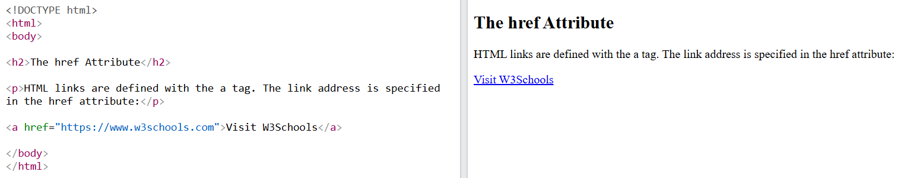
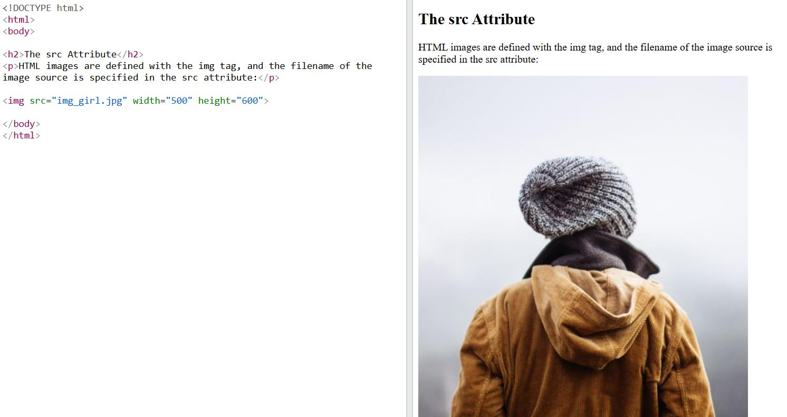
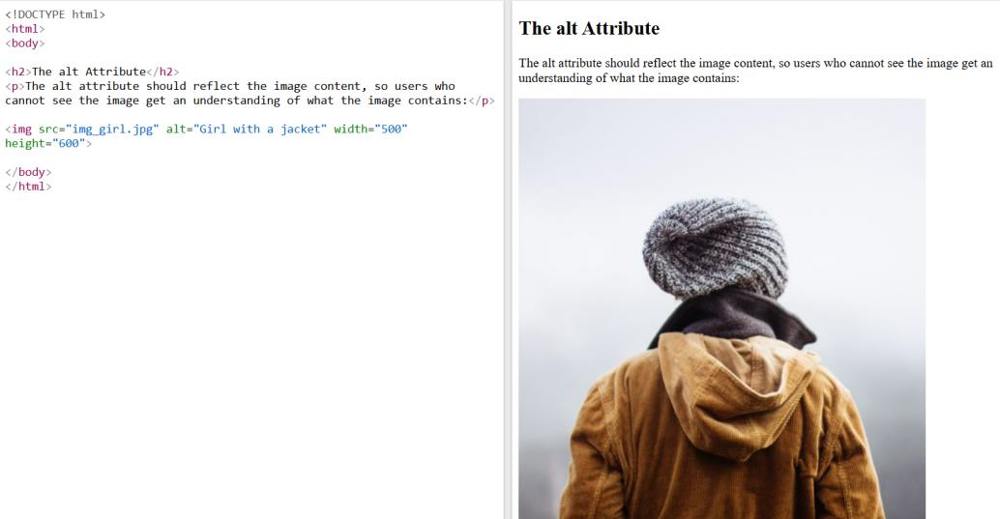

# 2 · Attributes 🏷️

> **TL;DR:** Attributes are extra settings you attach to an element's opening tag, written as `name="value"`.

## 💡 The big idea

If an element is a **person**, attributes are their **name tag and ID card**: where a link goes, which picture to show, what to call this thing. The element says *what it is*; the attributes give *extra information about it*.

## 🔍 The details

To provide further information about an element, **attributes** are used. They are usually written **inside the opening tag** as **name/value pairs**:

```html
<a href="https://example.com">Visit website</a>
     └─name─┘ └──── value ────┘
```

### `href` – where a link goes

`href` is used with `<a>` tags to define a URL for hyperlinks.

```html
<!DOCTYPE html>
<html lang="en">
  <body>
<h2> Href Attribute</h2>
<a href="https://example.com">Visit website</a>
  </body>
</html>
```



### `src` – which file to load

`src` is used with `` and specifies the **path to the image** to be displayed.

```html
<!DOCTYPE html>
<html lang="en">
  <body>
<h2> SRC Attribute</h2>

  </body>
</html>
```



### `alt` – the text alternative

`alt` is used with `` and specifies **alternate text** for an image if, for some reason, the image can't be displayed. This adds extra **accessibility** to your page: a screen reader reads the alt text aloud to someone who can't see the picture.

```html
<!DOCTYPE html>
<html lang="en">
  <body>
<h2> ALT Attribute</h2>

  </body>
</html>
```



> ✍️ **Writing good alt text:** describe what the image *shows or means*, e.g. "Students working on laptops in a cloud workshop". Avoid useless alt text like "image" or "photo".

### `id` and `class` – naming things

- `id` gives an element a **unique name** within the page.
- `class` **groups** elements that share a role or style.

CSS uses them to style elements, and JavaScript uses them to find elements.

```html
<!DOCTYPE html>
<html lang="en">
  <body>
<h2> ID and Class Attributes</h2>
<p id="intro" class="highlight">Welcome!</p>
<p class="highlight note">A paragraph can have several classes.</p>
</body>
</html>
```

| | `id` | `class` |
|---|---|---|
| Analogy | Your **passport number** – one per person | A **team jersey colour** – many players share it |
| How many elements can use the same one? | **Only one** per page | **As many as you like** |
| Can one element have several? | No, just one id | **Yes** – separate with spaces: `class="highlight note"` |
| Written in CSS as | `#intro` | `.highlight` |

### 📂 File paths: the #1 beginner gotcha

The value of `src` (and `href`) is a **path**, and it is **relative to the location of the HTML file**. Paths are also **case-sensitive on most servers** (`Workshop.jpg` ≠ `workshop.jpg`).

```
cloud-events/
├── index.html
└── images/
    └── workshop.jpg      ← from index.html this is:  src="images/workshop.jpg"
```

## 🛠️ Try it — Exercise 2

### Step 1 – Add an image (with a deliberate typo!)

Save any picture as `images/workshop.jpg`. Below the intro paragraph, add:

```html

```

Notice the **deliberate typo** (`.jpeg` instead of `.jpg`).

**What does the browser show?** A **broken-image icon** with the **alt text** next to it.
**Where does that text come from?** From the `alt` attribute. The browser couldn't find `images/workshop.jpeg`, so it fell back to your description.


> 🔎 **Detective move:** open DevTools (F12) → **Network** tab → reload. You'll see a red **404 Not Found** for `workshop.jpeg`. 404 means "the server (or your file system) has no such file".

Now **fix the file name** (`.jpg`) and reload — the picture appears. (`width="400"` is an attribute too: it sets the image's display width.)

### Step 2 – A skip link using `id`

1. Give the "Upcoming Workshops" `<h2>` an `id` of `workshops`:
   ```html
   <h2 id="workshops">Upcoming Workshops</h2>
   ```
2. At the very top of `<body>`, add:
   ```html
   <a href="#workshops">Skip to workshops</a>
   ```
3. Click it.

**You should see:** the page jumps down to the workshops heading. A `#` followed by an id **jumps to the element with that id**. (This "skip link" also helps keyboard and screen-reader users bypass a long menu.)

### Step 3 – Give every list item a class

```html
<li class="workshop">Introduction to AWS</li>
<li class="workshop">Getting Started with Google Cloud</li>
<li class="workshop">Cloud Security Basics</li>
```

### Step 4 – Find them in DevTools

Right-click the page → **Inspect** → **Elements** panel. Find your `id="workshops"` and your `class="workshop"` items. You'll use these hooks in the CSS and JavaScript chapters.

## ⚠️ Watch out

- Missing `alt` on images, or alt text that says nothing.
- Wrong file paths in `src` / `href` — check folder names and capitalisation.
- Using the same `id` twice on a page (ids must be unique).

## 📚 Go deeper

- [W3Schools – HTML attributes](https://www.w3schools.com/TAgs/ref_attributes.asp)
- [MDN – HTML attributes](https://developer.mozilla.org/en-US/docs/Web/HTML/Attributes)

---

⬅️ [1 · Elements](01-elements.md) · ➡️ Next: [**3 · Nesting**](03-nesting.md)
