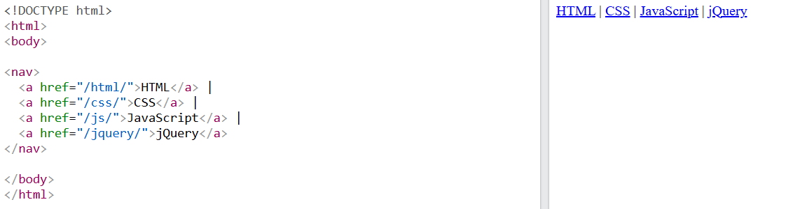
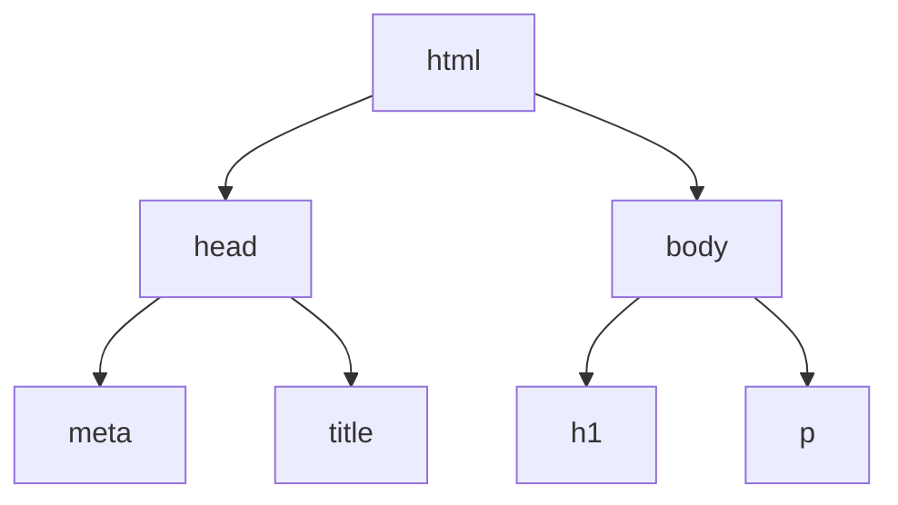

# 3 · Nesting 🪆

> **TL;DR:** Elements live inside other elements, forming a family tree. Close them in the reverse order you opened them.

## 💡 The big idea

Think of **Russian nesting dolls** (or folders inside folders). As a webpage grows, elements are **contained within each other**, forming a **hierarchy**. A `<body>` can contain a `<nav>`, which contains a `<ul>`, which contains `<li>` items, which contain `<a>` links.

```html
<body>
  <nav>
    <ul>
      <li><a href="/html/">HTML</a></li>
      <li><a href="/css/">CSS</a></li>
    </ul>
  </nav>
</body>
```

Here `<body>` contains a navigation section `<nav>`, which contains an unordered list `<ul>` — that's **the logic of nesting**.



## 🔍 The details

### Family vocabulary 👨‍👩‍👧

| Word | Meaning | In the example above |
|---|---|---|
| **Parent** | The outer element | `<nav>` is the parent of `<ul>` |
| **Child** | An element directly inside another | `<ul>` is a child of `<nav>` |
| **Sibling** | Elements at the same level | The `<li>` items are siblings |

### The golden rule of closing 🔑

> Elements must be closed in the **reverse order** to which they were opened: **the element opened last is closed first.**

```html
<!-- Correct -->
<p>This is <strong>important</strong>.</p>

<!-- Incorrect: the tags overlap -->
<p>This is <strong>important.</p></strong>
```

In the incorrect version `<strong>` was opened *after* `<p>`, so it must be closed *before* `</p>` — but here `</p>` comes first, so the two elements overlap instead of nesting neatly.

Think of stacking cups: you must lift off the top cup before the one underneath it.

### 🌳 The DOM (a sneak peek)

Behind the scenes, the browser reads your HTML and **builds a tree** of these parent/child relationships **in memory**. This tree is called the **DOM – Document Object Model**, and you'll work with it directly when we reach JavaScript. For the earlier "Event Registration" page it looks like this:

```
html
├── head
│    ├── meta
│    └── title
└── body
     ├── h1
     └── p
```

The same thing as a picture:



### A real-life bug this teaches you

When an image file isn't found, the browser shows the **alt text** instead of a picture. The file `workshop.jpg` was simply **not in the same folder** the path expected. This is one of the most common beginner problems — and a perfect example of why **alt text matters** and why **file paths in `src` and `href` are relative to the HTML file's location**.


## 🛠️ Try it — Exercise 3

### Step 1 – Navigation menu under the `<h1>`

Add a `<ul>` with three `<li>` items, each containing an `<a>`:

```html
<ul>
  <li><a href="#">Home</a></li>
  <li><a href="#workshops">Workshops</a></li>
  <li><a href="#register">Register</a></li>
</ul>
```

`href="#"` links to the top of the current page. `#workshops` jumps to your workshops heading. **The Register link won't work yet** — no element has `id="register"` until [Lesson 5](05-forms.md) (Exercise 5).

### Step 2 – Nest details inside each workshop `<li>`

After the workshop name, add an inner `<ul>` with two items:

```html
<li class="workshop">Introduction to AWS
  <ul>
    <li>Date: 12 October</li>
    <li>Level: Beginner</li>
  </ul>
</li>
<li class="workshop">Getting Started with Google Cloud
  <ul>
    <li>Date: 19 October</li>
    <li>Level: Beginner</li>
  </ul>
</li>
<li class="workshop">Cloud Security Basics
  <ul>
    <li>Date: 26 October</li>
    <li>Level: Intermediate</li>
  </ul>
</li>
```

**You should see:** an indented sub-list under each workshop, with a different bullet style. Nested lists are just lists inside list items.

### Step 3 – Group the page with three `<div>`s

```html
<a href="#workshops">Skip to workshops</a>     <!-- stays OUTSIDE all three -->

<div class="page-header">
  <h1>Cloud Computing Events</h1>
  <ul> … the menu … </ul>
</div>

<div class="page-content">
  … everything else …
</div>

<div class="page-footer">
  <p>&copy; 2026 Cloud Computing Events</p>
</div>
```

`&copy;` is an **HTML entity** – a code that displays the © symbol.

**You should see:** no visual change! `<div>` is an invisible box. It's just *grouping* for later styling.

### Step 4 – Break it on purpose 💥

Swap the order of two closing tags somewhere on your page. For instance, turn this:

```html
<p>All workshops are <span>free</span> for students.</p>
```

into this (the `</span>` and `</p>` now close in the wrong order):

```html
<p>All workshops are <span>free for students.</p></span>
```

Refresh, then **Inspect** the paragraph.

**How did the browser repair the mistake?** Browsers are very forgiving: they silently **fix** broken nesting while building the DOM tree, following built-in repair rules. In the **Elements** panel you'll see a tidy, properly nested tree — here, roughly `<p>… <span>free for students.</span></p>`, with the stray extra `</span>` ignored. Your source file is not changed; the browser repaired *its in-memory copy*. That forgiveness is convenient, but it means bugs can hide (and different mistakes get repaired differently), so keep your nesting tidy and run the validator in [Lesson 7](07-connecting-html-css-js.md). **Undo the change** afterwards.

## ⚠️ Watch out

- Overlapping tags (`<p><strong></p></strong>`).
- Forgetting to indent: indenting children by two spaces makes the family tree *visible* in your code, so mistakes jump out.

---

⬅️ [2 · Attributes](02-attributes.md) · ➡️ Next: [**4 · Semantic HTML**](04-semantic-html.md)
