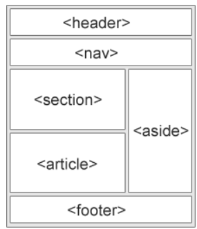

# 4 · Semantic HTML elements 🧭

> **TL;DR:** Pick tags for what content **means**, not for how you want it to look. `<nav>` says "navigation"; ten anonymous `<div>`s say nothing.

## 💡 The big idea

Imagine a building with **signs on every door**: "Reception", "Elevators", "Cafeteria". Now imagine the same building where every door just says "Room". Both work if you can see, but the signs make life dramatically easier — especially for someone using a screen reader, a search engine, or a new teammate.

**Semantic elements** are those signs. Not all HTML elements mean the same thing or achieve the same result. Semantic elements improve **accessibility**, **maintainability** and **code readability** by using the element made for a specific purpose, such as `<header>`, `<nav>`, `<main>`, `<section>`, `<article>`, `<footer>`.

> Choose elements based on **what the content means**, not only how you want it to look.

## 🔍 The details

### A typical page layout



| Element | Meaning | Typical use |
|---|---|---|
| `<header>` | Introductory area | Site title/logo (and often the menu) at the top of the page |
| `<nav>` | A block of **navigation links** | The site menu. Browsers and assistive technologies know it *is* the navigation menu |
| `<main>` | The **main content** unique to this page | Only one per page |
| `<section>` | A themed group of content, usually with a heading | "Upcoming Workshops", "Register" |
| `<article>` | A self-contained piece that would make sense on its own | One workshop card, a blog post, a comment |
| `<aside>` | Side content related to the main content | A "Did you know?" box |
| `<footer>` | Closing area | Copyright, contact info |

### Without vs. with semantics

```html
<!-- Without semantics -->
<div class="header">...</div>
<div class="nav">...</div>
<div class="content">...</div>
<div class="footer">...</div>

<!-- With semantics -->
<header>...</header>
<nav>...</nav>
<main>...</main>
<footer>...</footer>
```

Both look identical without CSS, but only the second one *says* what each part is.

### Why does it matter? 🤔

1. **♿ Accessibility.** Screen readers use elements such as `<nav>` and `<main>` as **landmarks**, so a user can jump straight to the navigation or the main content instead of listening to the whole page from the top.
2. **🔍 Search engines** also use the structure to understand what a page is about.
3. **🛠️ Maintainability.** A developer reading `<nav>` understands it immediately — unlike the tenth anonymous `<div>`.

### `<div>` and `<span>` still have a job

`<div>` and `<span>` are still useful **when no semantic element fits**, for example to group elements for styling.

### 📏 Rules of thumb

- **Use headings in order** (`h1`, then `h2`, then `h3`…) — don't skip levels or pick a heading just because it's the right *size*. (You can always resize with CSS.)
- **Use `<a>` to *go somewhere*** (a link) and **`<button>` to *do something*** (an action).

## 🛠️ Try it — Exercise 4

Continue with your same `index.html`.

1. **Header and nav.** Change `<div class="page-header">` into `<header>`. Wrap the menu `<ul>` in a `<nav>`.
2. **Main and section.** Change `<div class="page-content">` into `<main>`. Wrap the workshop heading and list in a `<section>` (keep the `id` on the `<h2>`).
3. **Articles.** Turn each workshop `<li>` into an `<article>` with the workshop name in an `<h3>`. Keep the inner details list and the `class` attributes. **Remove the outer `<ul>`**, which is no longer needed.
4. **Aside.** At the end of `<main>`, add an `<aside>` containing an `<h2>` "Did you know?" and a paragraph: "Cloud providers run data centres all over the world."
5. **Footer.** Change `<div class="page-footer">` into `<footer>`.
6. **Heading outline.** Write down the heading outline of your page (h1, then h2, then h3). Are any levels skipped?
7. **Landmarks.** Inspect, open the **Accessibility** tab, and find the landmarks (banner, navigation, main, complementary, footer) that your new elements created.

### ✅ What it should look like

```html
<section>
  <h2 id="workshops">Upcoming Workshops</h2>

  <article class="workshop">
    <h3>Introduction to AWS</h3>
    <ul>
      <li>Date: 12 October</li>
      <li>Level: Beginner</li>
    </ul>
  </article>

  <article class="workshop">
    <h3>Getting Started with Google Cloud</h3>
    <ul>
      <li>Date: 19 October</li>
      <li>Level: Beginner</li>
    </ul>
  </article>

  <article class="workshop">
    <h3>Cloud Security Basics</h3>
    <ul>
      <li>Date: 26 October</li>
      <li>Level: Intermediate</li>
    </ul>
  </article>
</section>
```

### 💬 Answers to the questions

**Heading outline (step 6):**

```
h1  Cloud Computing Events
 ├─ h2  Upcoming Workshops
 │    ├─ h3  Introduction to AWS
 │    ├─ h3  Getting Started with Google Cloud
 │    └─ h3  Cloud Security Basics
 ├─ h2  Register            (added in Lesson 5)
 └─ h2  Did you know?
```

No levels are skipped: you go `h1 → h2 → h3`, never `h1 → h3`. 🎉

**Landmarks (step 7):** the browser's Accessibility tree maps your tags to landmark roles:

| You wrote | Landmark role |
|---|---|
| `<header>` (top level) | **banner** |
| `<nav>` | **navigation** |
| `<main>` | **main** |
| `<aside>` | **complementary** |
| `<footer>` (top level) | **footer** — DevTools labels it *contentinfo* |

## ⚠️ Watch out

- Using a `<div>` where a semantic element or a `<button>` exists.
- Choosing headings for their **size** instead of their **meaning**, or skipping heading levels.

## 📚 Go deeper

- [W3Schools – semantic elements](https://www.w3schools.com/html/html5_semantic_elements.asp)
- [MDN – Accessibility](https://developer.mozilla.org/en-US/docs/Web/Accessibility)

---

⬅️ [3 · Nesting](03-nesting.md) · ➡️ Next: [**5 · Forms**](05-forms.md)
