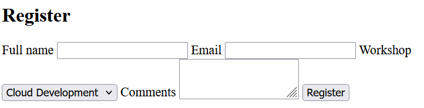

# 5 · Forms 📝

> **TL;DR:** A `<form>` collects what the user types and sends it to a server as `name=value` pairs when they press submit.

## 💡 The big idea

A form is a **paper registration slip** for the web. Each field is a labelled box. When the user hands it in (submits), the browser reads every filled-in box and mails the answers to an address (the `action` URL).

Forms are how a webpage **collects information from the user and sends it to a server**. This is the **first place where the browser sends a request to a server on the user's behalf**, so it is worth understanding well before working with servers and APIs ([Chapter 4](../04-nodejs-express-rest/README.md)).

## 🔍 The details

After the form is submitted, the browser collects **every named input** as `name=value` pairs and sends an **HTTP request** to the `action` URL.

```html
<form action="/register" method="post">
  <label for="fullname">Full name</label>
  <input type="text" id="fullname" name="fullname" required>

  <label for="email">Email</label>
  <input type="email" id="email" name="email" required>

  <label for="workshop">Workshop</label>
  <select id="workshop" name="workshop">
    <option value="cloud">Cloud Development</option>
    <option value="web">Web Development</option>
  </select>

  <label for="comments">Comments</label>
  <textarea id="comments" name="comments" rows="3"></textarea>

  <button type="submit">Register</button>
</form>
```



*(Ugly, right? That's plain HTML with no CSS. Chapter 2 will fix it.)*

### Key attributes

| Attribute | What it does | Friendly explanation |
|---|---|---|
| `action` | The URL the form data is sent to | The **address on the envelope** |
| `method` | The HTTP method used: `get` puts the data **in the URL**, `post` sends it **in the body** of the request | GET = a postcard (visible to anyone), POST = a sealed envelope. (Explained further when you work with servers and APIs.) |
| `name` | The key/title the value is sent under (for example `email=...`). **An input without a `name` is not submitted.** | The **label on the data** when it arrives |
| `id` + `for` | Connect a `<label>` to its input | Clicking the label focuses the field; screen readers announce it |
| `type` | Chooses the kind of input and its built-in checks: `text`, `email`, `password`, `number`, `date`, `checkbox`, `radio`, `file` and more | Picks the right keyboard on phones and validates the value |
| `required` | Stops the form from being submitted while the field is empty | A "you can't leave this blank" guard |

### `id` vs `name` — don't mix them up

The `id` and `name` on an input are **not the same thing**:

- `id` + the label's `for` → link the label to the input (**for the page**).
- `name` → the key under which the value is **sent to the server**.

### Other controls you'll use in the exercise

| Control | Code | Notes |
|---|---|---|
| Dropdown | `<select>` with `<option value="aws">` | The `value` is what's sent; the text between the tags is what's shown |
| Radio buttons | `<input type="radio" name="experience" value="beginner">` | Radios that **share the same `name`** form a group where only one can be chosen |
| Group | `<fieldset>` + `<legend>` | Draws a box around related controls and gives them a caption |
| Number | `<input type="number" min="0" max="3">` | Limits the range |
| Checkbox | `<input type="checkbox" name="reminders">` | Only sent when ticked |
| Multi-line text | `<textarea rows="3">` | Not a void element: it has a closing tag |

## 🛠️ Try it — Exercise 5

Inside `<main>`, **after the workshops section and before the `<aside>`**, add a new `<section>` with an `<h2 id="register">Register</h2>`. 🎉 The **Register link in your menu now works.**

Below the heading, add `<form action="/register" method="post">` and build these controls — **each with a `<label>` connected by `for` and `id`, and each with a `name`**:

| Control | Details |
|---|---|
| Full name | a text input, `required` |
| Email | an email input, `required` |
| Workshop | a `<select>` with one `<option>` per workshop. Give each option a short value such as `aws`, `gcp` and `security` |
| Experience level | three **radio buttons** (Beginner, Intermediate, Advanced) that share the same `name`, grouped in a `<fieldset>` with a `<legend>` |
| Number of guests | a number input with `min="0"` and `max="3"` |
| A checkbox | "Send me reminders" |
| Comments | a `<textarea>` |
| A submit button | `<button type="submit">` |

And give the `<form>` an `id` of `register-form` (JavaScript will use this in a later chapter).

### ✅ Solution

```html
<section>
  <h2 id="register">Register</h2>
  <form id="register-form" action="/register" method="post">

    <label for="fullname">Full name</label>
    <input type="text" id="fullname" name="fullname" required>

    <label for="email">Email</label>
    <input type="email" id="email" name="email" required>

    <label for="workshop">Workshop</label>
    <select id="workshop" name="workshop">
      <option value="aws">Introduction to AWS</option>
      <option value="gcp">Getting Started with Google Cloud</option>
      <option value="security">Cloud Security Basics</option>
    </select>

    <fieldset>
      <legend>Experience level</legend>
      <input type="radio" id="beginner" name="experience" value="beginner">
      <label for="beginner">Beginner</label>
      <input type="radio" id="intermediate" name="experience" value="intermediate">
      <label for="intermediate">Intermediate</label>
      <input type="radio" id="advanced" name="experience" value="advanced">
      <label for="advanced">Advanced</label>
    </fieldset>

    <label for="guests">Number of guests</label>
    <input type="number" id="guests" name="guests" min="0" max="3">

    <p class="checkbox-row">
      <input type="checkbox" id="reminders" name="reminders">
      <label for="reminders">Send me reminders</label>
    </p>

    <label for="comments">Comments</label>
    <textarea id="comments" name="comments" rows="3"></textarea>

    <button type="submit">Register</button>
  </form>
</section>
```

> The `class="checkbox-row"` on the checkbox paragraph is used by the CSS exercise later.

### Experiment 1 – Submit the empty form

**What does the browser do, and which attribute causes it?**
It **refuses to submit** and shows a little bubble like "Please fill out this field" next to the first empty required field. The cause is the **`required`** attribute (plus `type="email"`, which also checks the format: `sara@` would be rejected too). No request is sent at all.

### Experiment 2 – Make the data visible in the URL

Change `method` to `get` and `action` to the name of your own HTML file:

```html
<form id="register-form" action="index.html" method="get">
```

Fill in the form and submit. **Look at the address bar** — your data is in the URL:

```
…/index.html?fullname=Sara&email=sara%40example.com&workshop=aws&experience=beginner&guests=1&reminders=on&comments=Hi+there
```

This shows you exactly what "`name=value` pairs" means:

- Fields are joined by `&`, and each is `name=value`.
- Special characters are encoded (`@` became `%40`, a space becomes `+`).
- The **checkbox** appears (as `reminders=on`) **only if ticked**, and **only the chosen radio button** is sent.
- Any input without a `name` would be **missing** entirely.

That's also why `get` is wrong for passwords or long text: it ends up in the URL, browser history and server logs. When you're done, change it back to `action="/register" method="post"`. (With no server yet, submitting a `post` form to `/register` will just give an error page. That's expected until [Chapter 4](../04-nodejs-express-rest/README.md).)

## ⚠️ Watch out

- Form inputs **without a `name`** (the value is never sent) or **without a label**.
- Radio buttons with *different* `name`s (they stop being a group).

## 📚 Go deeper

- [MDN – the `<form>` element](https://developer.mozilla.org/en-US/docs/Web/HTML/Element/form)
- [MDN – the `<input>` element and its types](https://developer.mozilla.org/en-US/docs/Web/HTML/Element/input)
- [W3Schools – HTML forms](https://www.w3schools.com/html/html_forms.asp)
- [W3Schools – form input types](https://www.w3schools.com/html/html_form_input_types.asp)

---

⬅️ [4 · Semantic HTML](04-semantic-html.md) · ➡️ Next: [**6 · Tables & media**](06-tables-and-media.md)
