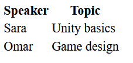

# 6 · Tables and media 📊🎬

> **TL;DR:** Use `<table>` for data that belongs in rows and columns, and `<video>` / `<audio>` (with `controls`) for media.

## 💡 The big idea

A table is a **spreadsheet on a page**: rows going across, columns going down, with heading cells that label them. Audio and video elements are **built-in media players** — one attribute gives you play, pause and volume buttons for free.

## 🔍 The details

### Tables

Use `<table>` for **tabular data**. Headings are `<th>` and data cells are `<td>`.

```html
<table>
  <thead>
    <tr><th>Speaker</th><th>Topic</th></tr>
  </thead>
  <tbody>
    <tr><td>Sara</td><td>Unity basics</td></tr>
    <tr><td>Omar</td><td>Game design</td></tr>
  </tbody>
</table>
```



> **Note:** the table above has **no borders**. CSS will adjust this later on (Chapter 2).

| Tag | Stands for | Job |
|---|---|---|
| `<table>` | table | The whole table |
| `<caption>` | caption | The table's title (used in the exercise) |
| `<thead>` | table head | Groups the heading row(s) |
| `<tbody>` | table body | Groups the data rows |
| `<tr>` | table row | One horizontal row |
| `<th>` | table header cell | A bold, centred label for a column (or row) |
| `<td>` | table data cell | One piece of data |

Think of it like a grid where **`tr` draws the rows** and **`th`/`td` fill the cells** of each row.

⚠️ Tables are for **data**, not for laying out a page. (People did that in the 1990s. Chapter 2's Flexbox and Grid are the modern way.)

### Audio and video

Audio and video work in a similar way. The **`controls`** attribute adds the browser's **built-in play, pause and volume buttons**:

```html
<video controls src="intro.mp4" width="400"></video>
<audio controls src="talk.mp3"></audio>
```

`controls` is a **boolean attribute**: its mere presence turns it on, no `="..."` needed.

## 🛠️ Try it — Exercise 6

1. **Figure and caption.** Wrap the workshop image in a `<figure>`, and add a `<figcaption>` below it: "Students collaborating during a past cloud workshop."

   ```html
   <figure>
     
     <figcaption>Students collaborating during a past cloud workshop.</figcaption>
   </figure>
   ```
   `<figure>` groups a picture with its caption so they belong together.

2. **A second class.** Give the "Introduction to AWS" `<article>` a second class so it reads `class="workshop featured"`, marking it as the highlighted workshop.

3. **A second id.** Give the workshops `<section>` an id of `workshop-list`, **in addition to** the id already on its `<h2>` (JavaScript will use this in a later chapter).

   ```html
   <section id="workshop-list">
     <h2 id="workshops">Upcoming Workshops</h2>
     …
   ```
   (Two ids on two *different* elements is perfectly fine — each is still unique on the page.)

4. **A schedule table.** Below the workshops section, add a new `<section>` with a `<table>`: a `<caption>Schedule</caption>`, a `<thead>` row of Workshop, Date, Time and Speaker, and a `<tbody>` with one row per workshop. Use **Sara, Omar and Lina** as the three speakers.

   ```html
   <section>
     <table>
       <caption>Schedule</caption>
       <thead>
         <tr>
           <th>Workshop</th>
           <th>Date</th>
           <th>Time</th>
           <th>Speaker</th>
         </tr>
       </thead>
       <tbody>
         <tr>
           <td>Introduction to AWS</td>
           <td>12 October</td>
           <td>10:00</td>
           <td>Sara</td>
         </tr>
         <tr>
           <td>Getting Started with Google Cloud</td>
           <td>19 October</td>
           <td>10:00</td>
           <td>Omar</td>
         </tr>
         <tr>
           <td>Cloud Security Basics</td>
           <td>26 October</td>
           <td>14:00</td>
           <td>Lina</td>
         </tr>
       </tbody>
     </table>
   ```

5. **Audio and video.** In the same section, after the table, add:

   ```html
     <video controls src="intro.mp4" width="400"></video>
     <audio controls src="talk.mp3"></audio>
   </section>
   ```
   so visitors can preview a past session.

6. **Reload the page without any CSS.** *Is the table readable? What about the video and audio controls?*

### 💬 What you'll notice

- **The table is readable but plain.** Text is aligned in columns and the header cells are bold, but there are **no borders or spacing**, so rows blur together. The caption sits above. That's exactly why the CSS chapter has a "schedule table" requirement.
- **The video and audio show controls** (play button, timeline, volume) **even though the files don't exist yet** — `intro.mp4` and `talk.mp3` aren't in your folder, so pressing play does nothing and the player looks disabled. The controls themselves come from the browser, not from you. Drop in real files to make them work.

## ⚠️ Watch out

- Using tables to lay out a page instead of presenting data.
- Forgetting `controls`, which leaves you with an invisible player.

## 📚 Go deeper

- [W3Schools – HTML tables](https://www.w3schools.com/Html/html_tables.asp)
- [MDN – Table basics](https://developer.mozilla.org/en-US/docs/Learn_web_development/Core/Structuring_content/HTML_table_basics)
- [MDN – Video and audio](https://developer.mozilla.org/en-US/docs/Learn_web_development/Core/Structuring_content/HTML_video_and_audio)

---

⬅️ [5 · Forms](05-forms.md) · ➡️ Next: [**7 · Connecting HTML to CSS & JavaScript**](07-connecting-html-css-js.md)
