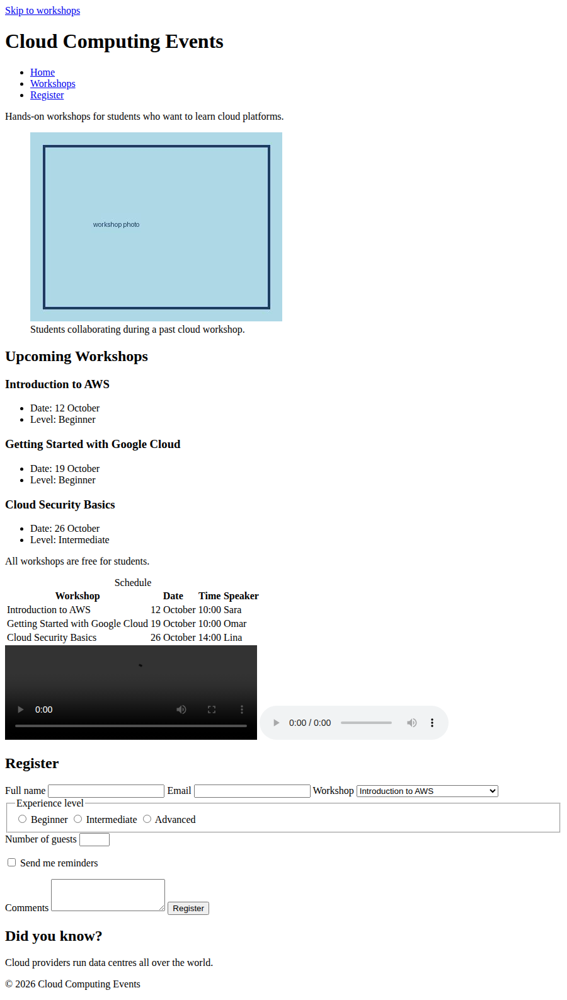

# 7 · Connecting HTML to CSS and JavaScript 🔌

> **TL;DR:** HTML describes structure only. Looks and behaviour live in separate files, which the page links to from its `<head>`.

## 💡 The big idea

Think of a theatre production 🎭. The **script** (HTML) says who is on stage and what they are. The **costume & set designer** (CSS) decides how everything looks. The **stage crew** (JavaScript) makes things move. They're separate teams working from separate files, and the `<head>` is where you tell the browser: *"here's where to find the designer and the crew."*

## 🔍 The details

Appearance and behaviour live in separate files that the page links to in the `<head>` of the HTML page:

```html
<head>
  <meta charset="UTF-8">
  <meta name="viewport" content="width=device-width, initial-scale=1.0">
  <title>Cloud Computing Events</title>
  <link rel="stylesheet" href="styles.css">
  <script src="app.js" defer></script>
</head>
```

| Line | What it does |
|---|---|
| `<meta charset="UTF-8">` | Makes special characters display correctly |
| `<meta name="viewport" …>` | Makes the page **scale properly on phones**. Without it, mobile browsers show a zoomed-out *desktop* layout |
| `<title>` | The text on the browser tab (also used in bookmarks and search results) |
| `<link rel="stylesheet" href="styles.css">` | **Loads a CSS file** |
| `<script src="app.js" defer></script>` | **Loads a JavaScript file.** `defer` lets the browser **finish reading the HTML first** and run the script **afterwards** |

### Why `defer`? ⏳

If a script ran *before* the HTML below it had been read, it would try to find elements that don't exist yet. `defer` says: "download this now, but wait to run it until the whole page is parsed." You'll see this bug in the flesh in [Chapter 3](../03-javascript/01-adding-javascript.md).

## 🛠️ Try it — Exercise 7: Finish the page

1. Give the page a real `<title>Cloud Computing Events</title>`.
2. Add these two lines inside `<head>`:
   ```html
   <link rel="stylesheet" href="styles.css">
   <script src="app.js" defer></script>
   ```
   **Neither file needs to exist yet** — you'll build them in the next two chapters. (The browser will just log a 404 for each in the Console; that's fine for now.)
3. Also make sure `<meta charset>` and the viewport `<meta>` are in the `<head>`.
4. **Run your page through the W3C Markup Validator** ([validator.w3.org](https://validator.w3.org/)) and fix any errors it reports. (Upload the file or paste the code.)
5. **Read back over the whole page in document order:**
   1. skip link
   2. header with nav
   3. intro paragraph
   4. figure
   5. the "Upcoming Workshops" section with three workshop articles
   6. the schedule section with its table, video and audio
   7. the Register form
   8. the aside
   9. the footer
6. **Check that every `id` and `class` used later in this book is present:**

| Needed by | Where it must be |
|---|---|
| `id="workshops"` | On the "Upcoming Workshops" **heading** (`<h2>`) |
| `id="workshop-list"` | On the workshops **`<section>`** |
| `class="featured"` | On the **Introduction to AWS** `<article>` (as `class="workshop featured"`) |
| `id="register"` | On the **Register heading** (`<h2>`) |
| `id="register-form"` | On the **`<form>`** |

(In the CSS chapter you'll also add `class="workshop-grid"` on the workshops `<section>` and `class="checkbox-row"` on the reminders paragraph. The reference solution below already includes them.)

## 🏁 Reference solution

The finished page after every exercise in this chapter is in [`solution/index.html`](solution/index.html). *There is more than one correct answer, so compare **structure and reasoning** rather than exact text.*

To make the finished page look right, the solution folder also needs a picture at `images/workshop.jpg` (a placeholder is included). `styles.css` and `app.js` don't exist yet — you write them in the next chapters. The `intro.mp4` and `talk.mp3` files are intentionally missing too.

<p align="center">
  <br>
  <em>Your page at the end of Chapter 1: fully structured, but still plain. (Chapter 2 makes it beautiful.)</em>
</p>

## ⚠️ Watch out

- A wrong path in `href` / `src` for the CSS or JS file, so nothing loads (check the Console and Network tabs).
- Forgetting the viewport `<meta>` tag, so a phone shows a tiny desktop page.

## 📚 Go deeper

- [W3C Markup Validator](https://validator.w3.org/)
- [Chrome DevTools documentation](https://developer.chrome.com/docs/devtools/)
- [MDN – Learn HTML (guided lessons and challenges)](https://developer.mozilla.org/en-US/docs/Learn/HTML)
- [W3Schools – HTML exercises](https://www.w3schools.com/html/html_exercises.asp) · [challenges](https://www.w3schools.com/html/html_challenges.asp)

---

⬅️ [6 · Tables & media](06-tables-and-media.md) · ➡️ Next: [**Common mistakes**](common-mistakes.md), then [**Chapter 2: CSS →**](../02-css/README.md)
