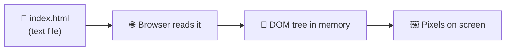

# Chapter 1 · HTML 🧱

> **HTML** (HyperText Markup Language) tells the browser **what the content is** and **how it is structured**.

## 💡 What is HTML?

Picture a Word document with no fonts or colours — just headings, paragraphs, lists and pictures in a sensible order. That's HTML: the **skeleton** of a web page. It doesn't say "make this red" (that's CSS) or "do something when clicked" (that's JavaScript). It says: *"this is a heading, this is a paragraph, this is a link, this is a form."*

## ⚙️ How does it work?

HTML documents have a **hierarchical structure**: elements sit inside other elements, like boxes inside boxes. Each element defines the **structure and meaning** of a piece of content.

When the browser downloads your `.html` file, it reads it top to bottom and builds a **tree** of those boxes in memory (called the **DOM** – you'll meet it properly in Chapter 3). Everything you see on a page comes from that tree.



## 📖 Lessons in this chapter

| # | Lesson | In one sentence |
|---|---|---|
| 1 | [Elements](01-elements.md) | The building blocks: tags, the page skeleton, void / block / inline |
| 2 | [Attributes](02-attributes.md) | Extra settings on an element: `href`, `src`, `alt`, `id`, `class` |
| 3 | [Nesting](03-nesting.md) | Elements inside elements: parents, children, siblings, and the DOM tree |
| 4 | [Semantic HTML](04-semantic-html.md) | Choosing tags for *meaning*: `<header>`, `<nav>`, `<main>`… |
| 5 | [Forms](05-forms.md) | How a page collects information and sends it to a server |
| 6 | [Tables & media](06-tables-and-media.md) | Tabular data, audio and video |
| 7 | [Connecting HTML to CSS & JavaScript](07-connecting-html-css-js.md) | Linking the other two files, plus the final checklist |
| ✅ | [Common mistakes](common-mistakes.md) | The classic traps, and how to dodge them |
| 🏁 | [Reference solution](solution/index.html) | The finished page after all the exercises |

## 🎒 Before you start

1. Create a folder for the project, e.g. `cloud-events/`.
2. Open it in your editor (VS Code, for example).
3. You'll create `index.html` in Lesson 1 and keep editing the **same file** through the whole chapter.

> 📌 **Remember:** "All coming exercises are sequential and build on each other." Don't start a fresh page for each exercise — keep adding to the same one.

## 🧾 Chapter cheat sheet

```html
<!DOCTYPE html>                       <!-- "use modern HTML" -->
<html lang="en">                      <!-- the whole page; lang = page language -->
  <head>                              <!-- info ABOUT the page (not shown) -->
    <meta charset="UTF-8">            <!-- display accents, Arabic, emoji correctly -->
    <meta name="viewport" content="width=device-width, initial-scale=1.0">
    <title>Tab title</title>
    <link rel="stylesheet" href="styles.css">
    <script src="app.js" defer></script>
  </head>
  <body>                              <!-- what the visitor sees -->
    <header>…<nav>…</nav></header>
    <main>
      <section>…<article>…</article></section>
      <aside>…</aside>
    </main>
    <footer>…</footer>
  </body>
</html>
```

Next up: [**Lesson 1 – Elements →**](01-elements.md)
