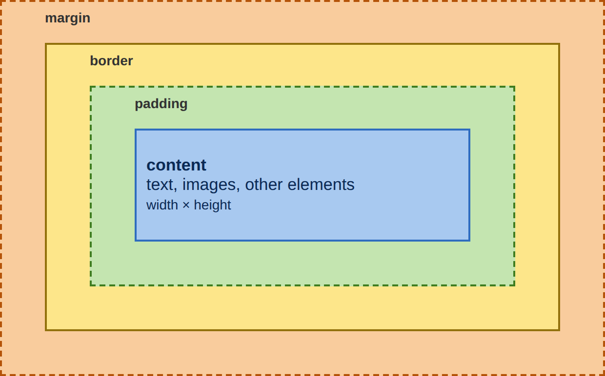
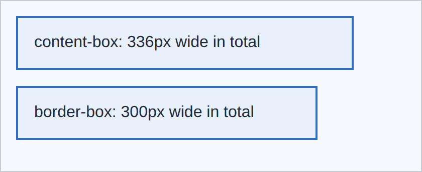

# 4 · The box model 📦

> **TL;DR:** Every element is a rectangle made of four layers: content, padding, border and margin. Set `box-sizing: border-box` to make sizes predictable.

## 💡 The big idea

Picture a **framed painting hanging on a wall**:

- the **painting** is the *content*;
- the **mat** (the cardboard border inside the frame) is the *padding*;
- the **frame** itself is the *border*;
- the **empty wall space** between this painting and the next is the *margin*.

Every HTML element is drawn as a rectangular box made of these four layers.



## 🔍 The details

| Layer | Property | What it is |
|---|---|---|
| Content | `width`, `height` | The text, image or child elements |
| Padding | `padding` | Space between the content and the border, **inside** the background |
| Border | `border` | A line around the padding |
| Margin | `margin` | Space **outside** the border that separates the element from its neighbours. It is always **transparent** |

Background colour paints the content and padding (and reaches under the border), but never the margin.

### The size surprise ⚠️

By default, `width` sets **only the content width**, so padding and border are *added on top*:

```
300 (content) + 32 (padding: 1rem = 16px × 2 sides) + 4 (border: 2px × 2 sides) = 336px
```

Your `width: 300px` box ends up 336px wide! Setting `box-sizing: border-box` makes `width` **include** the padding and border, which is much easier to reason about.

```css
.box {
  width: 300px;
  padding: 1rem;
  border: 2px solid #2f6dbf;
  margin-bottom: 1rem;
  background-color: #e8f1fb;
}

.content-box { box-sizing: content-box; }   /* default: 300 + 32 + 4 = 336px */
.border-box  { box-sizing: border-box; }    /* 300px in total */
```

**Result:**



### The universal reset

Most projects start with this rule, which applies border-box sizing to **every** element:

```css
* {
  box-sizing: border-box;
}
```

(`*` is the "select everything" selector.)

### Shorthand: one to four values

`margin` and `padding` accept one to four values:

```css
margin: 10px;                /* all four sides */
margin: 10px 20px;           /* top and bottom | left and right */
margin: 10px 20px 30px 40px; /* top | right | bottom | left (clockwise) */
margin: 0 auto;              /* no vertical margin, centred horizontally */
```

Memory trick for four values: start at 12 o'clock and go **clockwise** — **T**op, **R**ight, **B**ottom, **L**eft ("**TRouBLe**").

`margin: 0 auto` is the classic way to centre a block that has a width: `auto` splits the leftover horizontal space equally on the left and the right.

## 🛠️ Try it — Exercise 4

1. **Select any element in DevTools and find the box-model diagram** in the Computed or Styles pane. **Hover over it** to see the margin and padding highlighted on the page. It's the same picture as above, but with your real numbers.
2. **Give `.workshop` a width, padding and border. Measure it in DevTools with and without `box-sizing: border-box`.**
   ```css
   .workshop { width: 300px; padding: 1rem; border: 2px solid #2f6dbf; }
   ```
   Without border-box, DevTools reports **336px** (300 + 32 + 4). With `* { box-sizing: border-box; }`, it reports exactly **300px**, and the content area shrinks to fit.
3. **Centre `main` on the page.**
   ```css
   main {
     max-width: 60rem;
     margin: 0 auto;
   }
   ```
   `max-width` means "as wide as needed, but never wider than 60rem" (so it still shrinks nicely on phones).
4. **Set `margin: 0` on the `<h1>`.** *What changes above and below it? Which default margins do headings and paragraphs have?*
   The gap above and below the heading disappears. Browsers give headings and paragraphs **default vertical margins** (a paragraph has about 1em top and bottom; a heading has roughly 0.67em–1em+ depending on the level), which is why unstyled pages have that familiar breathing room. DevTools shows them as orange areas in the box-model diagram.

## ⚠️ Watch out

- Forgetting `box-sizing: border-box`, so boxes are wider than expected.
- Confusing padding (inside the border) with margin (outside).

## 📚 Go deeper

- [W3Schools – CSS Box Model](https://www.w3schools.com/css/css_boxmodel.asp)
- [MDN – The CSS box model](https://developer.mozilla.org/en-US/docs/Web/CSS/CSS_box_model)

---

⬅️ [3 · Colours, text and units](03-colors-text-and-units.md) · ➡️ Next: [**5 · The cascade**](05-the-cascade.md)
