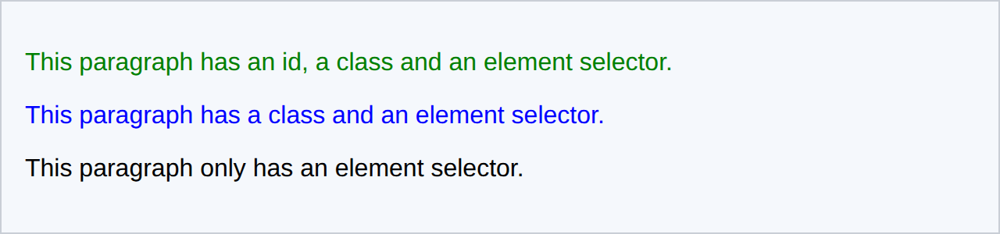

# 5 · The cascade: inheritance and specificity ⚖️

> **TL;DR:** When several rules compete for the same property, the browser picks a winner using specificity, then source order. Text styles are inherited; layout styles are not.

## 💡 The big idea

The "C" in CSS is for **Cascading**: rules "fall" down from many sources and the browser has to settle disputes. Think of a **family rule system**:

- **Inheritance** – kids follow the family's general rules unless told otherwise ("everyone speaks English at dinner").
- **Specificity** – a *specific* instruction beats a general one ("Sara, please sit here" beats "everyone sit anywhere").
- **Order** – if two instructions are equally specific, the **later** one wins.

## 🔍 The details

### Inheritance

Some properties are **passed from a parent to its children**. Text properties such as `color`, `font-family` and `line-height` are inherited, so setting them once on `body` styles the whole page. Layout properties such as `border`, `margin`, `padding` and `background` are **not** inherited.

```css
body {
  color: #1f2937;             /* inherited by every element inside <body> */
  font-family: Arial, sans-serif;
}

.workshop {
  border: 1px solid gray;     /* not inherited: each element needs its own */
}
```

(It would be silly if a border on a `<section>` were copied around every element inside it!)

### Specificity

When two rules set the same property on the same element, the **more specific** selector wins, no matter which comes first in the file. From weakest to strongest: element selectors, then classes (also attributes and pseudo-classes), then ids, then the inline `style` attribute. **When specificity is equal, the rule that comes later wins.**

| Selector | Example | Specificity (ids-classes-elements) |
|---|---|---|
| Element | `p` | 0-0-1 |
| Class, attribute, pseudo-class | `.note`, `[type="email"]`, `:hover` | 0-1-0 |
| ID | `#intro` | 1-0-0 |
| Inline style | `style="..."` | Beats all of the above |

Compare them column by column, left to right, like a scoreboard where ids count most, then classes, then elements. (A `0-1-0` beats a `0-0-9`: nine element selectors never add up to one class.)

```css
p      { color: black; }   /* specificity 0-0-1 */
.note  { color: blue; }    /* specificity 0-1-0 */
#intro { color: green; }   /* specificity 1-0-0 */
```

```html
<p id="intro" class="note">This paragraph has an id, a class and an element selector.</p>
<p class="note">This paragraph has a class and an element selector.</p>
<p>This paragraph only has an element selector.</p>
```

**Result:**



Green, blue, black: each paragraph is matched by every rule it qualifies for, and the most specific one wins.

## 🛠️ Try it — Exercise 5

1. **Predict the colour of each paragraph in the example above, then type it into your page and check.**
   Paragraph 1 matches all three rules → the id rule (1-0-0) wins → **green**. Paragraph 2 matches `p` and `.note` → the class rule wins → **blue**. Paragraph 3 matches only `p` → **black**.
2. **In the DevTools Styles pane, find declarations that are crossed out.** *Which rule replaced each of them, and why?* The crossed-out `color: black` and `color: blue` on paragraph 1 lost to the `#intro` rule because its specificity is higher. DevTools lists the winning rule at the top of the pane.
3. **Write two rules of equal specificity that set different colours, then swap their order.** *What changes?*
   ```css
   .note { color: blue; }
   .note { color: red; }    /* later wins → red. Swap them and it becomes blue. */
   ```
   With equal specificity, **source order** decides: the last one wins.
4. **Add `!important` to a losing rule to make it win. Then remove it and fix the problem with a better selector instead.**
   ```css
   p { color: black !important; }   /* beats even #intro… which is why it's dangerous */
   ```
   `!important` overrides normal specificity, so the *next* person who needs to override it needs another `!important`, and the stylesheet turns into an arms race. Prefer a more specific selector (for example `p.note` or `.card p`) or reorder your rules.

## ⚠️ Watch out

- Fighting specificity with `!important` instead of restructuring the selectors.
- Expecting a border or margin on a parent to be inherited by its children.

## 📚 Go deeper

- [W3Schools – CSS Specificity](https://www.w3schools.com/css/css_specificity.asp)
- [MDN – Specificity](https://developer.mozilla.org/en-US/docs/Web/CSS/Specificity)

---

⬅️ [4 · The box model](04-the-box-model.md) · ➡️ Next: [**6 · Display and positioning**](06-display-and-positioning.md)
