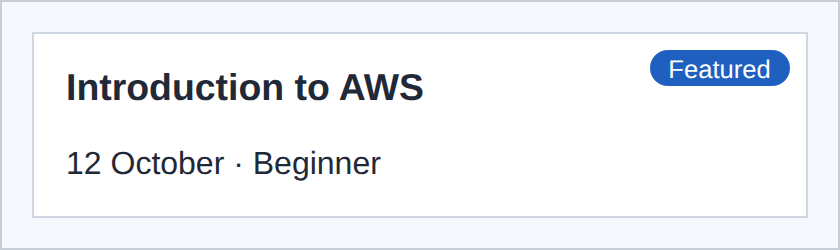

# 6 · Display and positioning 🧲

> **TL;DR:** `display` decides how an element takes part in the layout (block, inline, hidden…). `position` lets you pull an element out of the normal flow or pin it somewhere.

## 💡 The big idea

Normally the browser lays elements out like **words on a page**: block elements stack top to bottom (like paragraphs), inline elements flow side by side (like words). `display` lets you change an element's type; `position` is the "let me put this sticker exactly here" tool.

## 🔍 The details

### `display`

The `display` property controls how an element takes part in the layout. It is the block and inline distinction from [HTML Lesson 1](../01-html/01-elements.md), and **you can change it**.

| `display` | Behaviour |
|---|---|
| `block` | Starts on a new line and takes the full width. `width`, `height` and `margin` all apply |
| `inline` | Flows inside a line of text. `width` and `height` are **ignored** |
| `inline-block` | Flows like inline text, but `width`, `height`, `padding` and `margin` apply |
| `none` | **Removes** the element from the page: nothing is drawn and no space is kept |
| `flex`, `grid` | Turns the element into a flex or grid container ([Lesson 7](07-flexbox.md) and [Lesson 8](08-grid.md)) |

### `position`

The `position` property takes an element **out of the normal flow**, or fine-tunes where it sits:

| `position` | Behaviour | Analogy |
|---|---|---|
| `static` | The default: normal flow. `top`, `left` and similar have **no effect** | Sitting in your assigned seat |
| `relative` | Stays in the flow, can be nudged with `top` and `left`, and becomes the **reference point** for absolutely positioned children | Your seat — but you also become the landmark others measure from |
| `absolute` | Removed from the flow and placed relative to the **nearest positioned ancestor** | "Stand 10 cm from the top-right corner of *that* table" |
| `fixed` | Placed relative to the **browser window** and stays there while the page scrolls | A sticker on the screen glass |
| `sticky` | Scrolls normally until it reaches an offset such as `top: 0`, then **sticks** | A sticky note that follows you down the page once you reach it |

"Positioned" means "has any `position` other than `static`". If no ancestor is positioned, `absolute` measures from the page itself, which is rarely what you want. That's why the badge example below makes its parent `relative`.

```css
.workshop {
  position: relative;   /* the badge is placed inside this box */
  padding: 1rem;
  border: 1px solid #d0d7e2;
  background-color: white;
}

.badge {
  position: absolute;
  top: 0.5rem;
  right: 0.5rem;
  padding: 0.1rem 0.6rem;
  background-color: #1f5fbf;
  color: white;
  border-radius: 999px;
  font-size: 0.8rem;
}
```

**Result:**



And a sticky header:

```css
header {
  position: sticky;    /* stays visible while the page scrolls */
  top: 0;
}
```

## 🛠️ Try it — Exercise 6

1. **Set the menu `<li>` items to `display: inline-block` and give the links padding and a background so they look like buttons.** Notice the small gap between them: it comes from the **whitespace in your HTML**.
   ```css
   nav li { display: inline-block; }
   nav a  { display: inline-block; padding: 0.4rem 0.8rem; background-color: #1f5fbf; color: white; }
   ```
   (For this exercise, start from a plain list; if the menu is already a flex row from the next lesson, the gap disappears.) Inline-blocks behave like words, and the line break between your `<li>` tags counts as a space between words. Flexbox (Lesson 7) is the modern way to avoid that.
2. **Apply `display: none` to a paragraph, then try `visibility: hidden` instead.** *Which one keeps its space on the page?*
   **`visibility: hidden` keeps the space** (an invisible box remains). `display: none` removes it entirely, and the content below moves up.
3. **Add a "Featured" `<span class="badge">` to the featured workshop and place it in the corner with `position: relative` and `position: absolute`.**
   ```html
   <article class="workshop featured">
     <span class="badge">Featured</span>
     <h3>Introduction to AWS</h3>
     …
   ```
   Then use the CSS above: `position: relative` on `.workshop` and `position: absolute` with `top`/`right` on `.badge`. **Try removing `position: relative`** from the card and watch the badge fly off to a corner of the whole page.
4. **Make the header `position: sticky; top: 0;` and scroll the page. Give it a background colour, and see why it needs one.**
   Without a background colour the header is transparent, so page content scrolls visibly *through* the sticky header and the text overlaps. A solid background covers what passes underneath.

## ⚠️ Watch out

- Using `position: absolute` to lay out a page. It removes elements from the flow so neighbours don't make room for them. Use Flexbox and Grid instead.

## 📚 Go deeper

- [W3Schools – CSS Display](https://www.w3schools.com/css/css_display_visibility.asp)
- [W3Schools – CSS Positioning](https://www.w3schools.com/css/css_positioning.asp)
- [MDN – `position`](https://developer.mozilla.org/en-US/docs/Web/CSS/position) · [`display`](https://developer.mozilla.org/en-US/docs/Web/CSS/display)

---

⬅️ [5 · The cascade](05-the-cascade.md) · ➡️ Next: [**7 · Flexbox**](07-flexbox.md)
