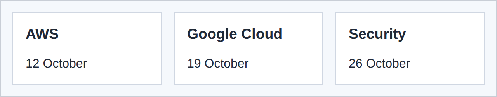

# 7 · Flexbox ↔️

> **TL;DR:** Flexbox lays items out in one direction at a time (a row or a column). Set `display: flex` on the container and its direct children become flex items.

## 💡 The big idea

Imagine **people standing in a line** and a coach who says: "Space yourselves evenly", "Stand in the middle", "Everybody take an equal share of the room". Flexbox is that coach. It's perfect for menus, toolbars and rows of buttons or cards.

## 🔍 The details

| Property | What it does | Common values |
|---|---|---|
| `display` | Makes the element a flex **container** | `flex` |
| `flex-direction` | Direction of the **main axis** | `row` (default), `column` |
| `justify-content` | Spacing **along** the main axis | `flex-start`, `center`, `space-between`, `space-around` |
| `align-items` | Alignment **across** the main axis | `stretch` (default), `center`, `flex-start` |
| `gap` | Space between the items | `1rem` |
| `flex-wrap` | Lets items wrap onto new lines | `nowrap` (default), `wrap` |
| `flex` (on an item) | How much of the free space the item takes | `flex: 1` |

### The two axes 🧭

`justify-content` works along the **main axis** (horizontal in a row) and `align-items` works along the **cross axis** (vertical in a row). Switching `flex-direction` to `column` **swaps them**.

```
flex-direction: row                       flex-direction: column
 main axis  ───────────►                   main axis  │
 ┌────────┬────────┬────────┐                          ▼
 │ item 1 │ item 2 │ item 3 │  cross axis ↓            ┌──────────┐
 └────────┴────────┴────────┘                          │  item 1  │
                                                       ├──────────┤   cross axis →
                                                       │  item 2  │
                                                       └──────────┘
```

### Example 1: a header with a menu

```css
header {
  display: flex;
  justify-content: space-between;
  align-items: center;
  padding: 1rem 2rem;
  background-color: #1f3864;
  color: white;
}

header h1 {
  margin: 0;
  font-size: 1.5rem;
}

nav ul {
  display: flex;
  gap: 1.5rem;
  margin: 0;
  padding: 0;
  list-style: none;
}

nav a {
  color: white;
  text-decoration: none;
}
```

**Result:**


### Example 2: equal-width cards

```css
.cards {
  display: flex;
  gap: 1rem;
}

.cards article {
  flex: 1;   /* every card takes an equal share of the row */
  padding: 1rem;
  background-color: white;
  border: 1px solid #d0d7e2;
}
```

**Result:**



## 🛠️ Try it — Exercise 7

1. **Turn the menu `<ul>` into a horizontal row with a gap and no bullets.**
   ```css
   nav ul { display: flex; gap: 1.5rem; list-style: none; margin: 0; padding: 0; }
   ```
2. **Put the site title on the left and the menu on the right with `justify-content: space-between`, and centre them vertically with `align-items: center`.** Put `display: flex` on the `<header>` (see Example 1). `space-between` pushes the first and last items to the edges, and `align-items: center` centres them across the row's height.
3. **Put three cards in a row with `flex: 1`. Then give the first card `flex: 2`. What happens?**
   The first card becomes **about twice as wide** as the others: the free space is split in the ratio 2 : 1 : 1.
4. **Change `flex-direction` to `column`, and predict what `justify-content` and `align-items` will do before you refresh.**
   The axes swap: `justify-content` now spaces items **vertically** (you'll only see an effect if the container is taller than its content, e.g. give it a `height`) and `align-items` now aligns them **horizontally**.
5. **Play the first ten levels of [Flexbox Froggy](https://flexboxfroggy.com/).** 🐸 It's a game that teaches these properties.

## ⚠️ Watch out

- Putting `display: flex` on the *wrong element*: it affects only its **direct children**, not deeper descendants.
- Forgetting which axis `justify-content` and `align-items` work on after switching to `column`.

## 📚 Go deeper

- [W3Schools – CSS Flexbox](https://www.w3schools.com/css/css3_flexbox.asp)
- [MDN – Flexbox](https://developer.mozilla.org/en-US/docs/Web/CSS/CSS_flexible_box_layout)
- [Flexbox Froggy (a game)](https://flexboxfroggy.com/)

---

⬅️ [6 · Display and positioning](06-display-and-positioning.md) · ➡️ Next: [**8 · Grid**](08-grid.md)
