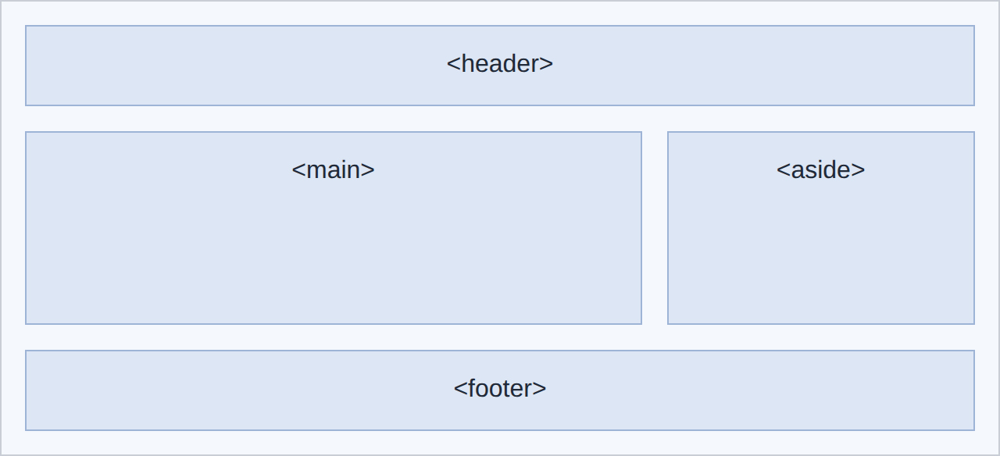

# 8 · Grid ▦

> **TL;DR:** Grid lays items out in rows *and* columns at the same time. Set `display: grid` on a container, describe its columns, and the children fall into the cells.

## 💡 The big idea

If Flexbox is people in a line, Grid is a **chessboard or a spreadsheet**: you define the columns (and optionally rows), and every child drops into the next free cell. It's the natural tool for page layouts and galleries of cards.

## 🔍 The details

| Property | What it does | Example |
|---|---|---|
| `grid-template-columns` | Defines the columns | `repeat(3, 1fr)` |
| `grid-template-rows` | Defines the rows (optional: rows are added as needed) | `auto 1fr auto` |
| `gap` | Space between rows and columns | `1rem` |
| `grid-column` | Lets an item **span** columns | `1 / -1` (first to last line) |
| `grid-template-areas`, `grid-area` | **Name** regions and place items in them | `"header header"` |

The **`fr` unit** means *one share of the free space*: `2fr 1fr` makes the first column twice as wide as the second. `repeat(3, 1fr)` is shorthand for `1fr 1fr 1fr`.

### Example 1: a gallery of three cards

```css
.cards {
  display: grid;
  grid-template-columns: repeat(3, 1fr);
  gap: 1rem;
}

.cards article {
  padding: 1rem;
  background-color: white;
  border: 1px solid #d0d7e2;
}
```

**Result:** (six cards shown, so you can see how they wrap to a second row)


### Example 2: a full page layout with named areas

Named areas make a whole page layout easy to read. This one recreates the semantic layout from [HTML Lesson 4](../01-html/04-semantic-html.md). (The background colours in the preview are only there to make the areas visible.)

```css
.layout {
  display: grid;
  grid-template-columns: 2fr 1fr;
  grid-template-areas:
    "header header"
    "main    aside"
    "footer footer";
  gap: 1rem;
}

header { grid-area: header; }
main   { grid-area: main; }
aside  { grid-area: aside; }
footer { grid-area: footer; }
```

**Result:**



The text map in `grid-template-areas` is literally a drawing of the layout: each quoted string is a row, each word a cell, and repeating a name (`header header`) makes that area span cells.

### Flexbox or Grid?

> **Rule of thumb:** use **Flexbox** for components that lay out in **one direction** (menus, toolbars, a row of buttons) and **Grid** for layouts in **two dimensions** (page layouts, galleries of cards).

## 🛠️ Try it — Exercise 8

1. **Display the three workshop articles in a three-column grid with a gap.** Put `display: grid` on the container that directly holds the articles (the `<section class="workshop-grid">`):
   ```css
   .workshop-grid { display: grid; grid-template-columns: repeat(3, 1fr); gap: 1rem; }
   ```
2. **The "Upcoming Workshops" heading ended up in the first cell. Make it span all columns with `grid-column: 1 / -1`.** *Why did it need that?*
   ```css
   #workshops { grid-column: 1 / -1; }
   ```
   The `<h2>` is a **direct child** of the grid container, so it's a grid item like any other and took the first cell, pushing the cards along. `1 / -1` means "start at the first column line and end at the last one", so the heading spans the whole row.
3. **Recreate the header, main, aside and footer layout above with `grid-template-areas`.** Use the Example 2 code on a wrapper (or a temporary test page) whose children are a header, a main, an aside and a footer.
4. **Play [CSS Grid Garden](https://cssgridgarden.com/).** 🥕

## ⚠️ Watch out

- Using `position: absolute` or tables to lay out a page instead of Flexbox and Grid.
- Forgetting that only the **direct children** of a grid container become grid items.

## 📚 Go deeper

- [W3Schools – CSS Grid](https://www.w3schools.com/css/css_grid.asp)
- [MDN – Grid layout](https://developer.mozilla.org/en-US/docs/Web/CSS/CSS_grid_layout)
- [CSS Grid Garden (a game)](https://cssgridgarden.com/)

---

⬅️ [7 · Flexbox](07-flexbox.md) · ➡️ Next: [**9 · Responsive design**](09-responsive-design.md)
