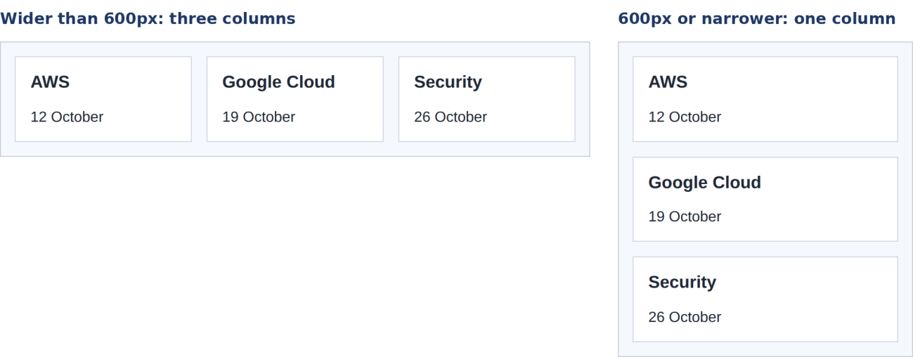

# 9 · Responsive design 📱💻🖥️

> **TL;DR:** A responsive page adapts to the space it has. Use the viewport meta tag, flexible sizing, and media queries.

## 💡 The big idea

Water takes the shape of its container. A responsive page does the same: people open your page on phones, tablets, laptops and large monitors, and it should look good on all of them without separate versions.

## 🔍 The details

Three tools do most of the work:

1. **The viewport meta tag** from [HTML Lesson 7](../01-html/07-connecting-html-css-js.md). Without it, phones pretend to be a wide desktop screen and shrink the page.
2. **Flexible sizing:** percentages, `max-width`, `rem`, and images that never exceed their container.
3. **Media queries:** rules that apply **only when a condition is true**, for example when the window is narrower than a given width.

```css
img {
  max-width: 100%;   /* never wider than the space available */
  height: auto;
}

@media (max-width: 600px) {
  .cards {
    grid-template-columns: 1fr;   /* one column on small screens */
  }
}
```

**Result:**



Read the media query out loud: *"When the window is 600px wide **or narrower**, apply these rules."* Everything inside the braces is a normal CSS rule that only switches on then.

### Mobile first 📱➡️🖥️

A common approach is **mobile first**: write the styles for small screens first, then add `min-width` queries for larger ones:

```css
.cards { display: grid; gap: 1rem; }        /* phones: one column by default */

@media (min-width: 700px) {
  .cards { grid-template-columns: repeat(3, 1fr); }   /* bigger screens: 3 columns */
}
```

**Choose breakpoints where your content starts to look bad, not to match particular devices.** New devices appear constantly, but your content's limits stay the same.

To test, open DevTools and toggle the **device toolbar** (**Ctrl+Shift+M**).

## 🛠️ Try it — Exercise 9

1. **Open the DevTools device toolbar, choose a phone size and reload your page.**
2. **Make the workshop cards a single column below 600px, and stack the header and menu vertically.**
   ```css
   @media (max-width: 600px) {
     .workshop-grid { grid-template-columns: 1fr; }
     header { flex-direction: column; }
   }
   ```
3. **Remove the viewport `<meta>` tag and view the page at a phone size. What is different? Then put it back.**
   Without it, the phone pretends to be a wide (~980px) desktop screen and shrinks the whole page to fit, so text is tiny. Your media queries also don't fire, because the browser thinks the "window" is wide.
4. **Slowly narrow the window. At what width does your page start to look bad? Add a breakpoint there.** Drag the edge of the responsive view until something breaks (cards squashed, menu wrapping…), note that width, and use it in a new `@media (max-width: …)` rule. The reference stylesheet chose 700px.

## ⚠️ Watch out

- Fixed pixel widths that force sideways scrolling on phones.
- A wide table that breaks the page: let it scroll inside its own container (`overflow-x: auto`).

## 📚 Go deeper

- [W3Schools – Responsive Web Design](https://www.w3schools.com/css/css_rwd_intro.asp)
- [W3Schools – Media queries](https://www.w3schools.com/css/css3_mediaqueries.asp) · [MDN – Using media queries](https://developer.mozilla.org/en-US/docs/Web/CSS/CSS_media_queries/Using_media_queries)

---

⬅️ [8 · Grid](08-grid.md) · ➡️ Next: [**Capstone: style the whole page**](10-capstone-style-the-page.md)
