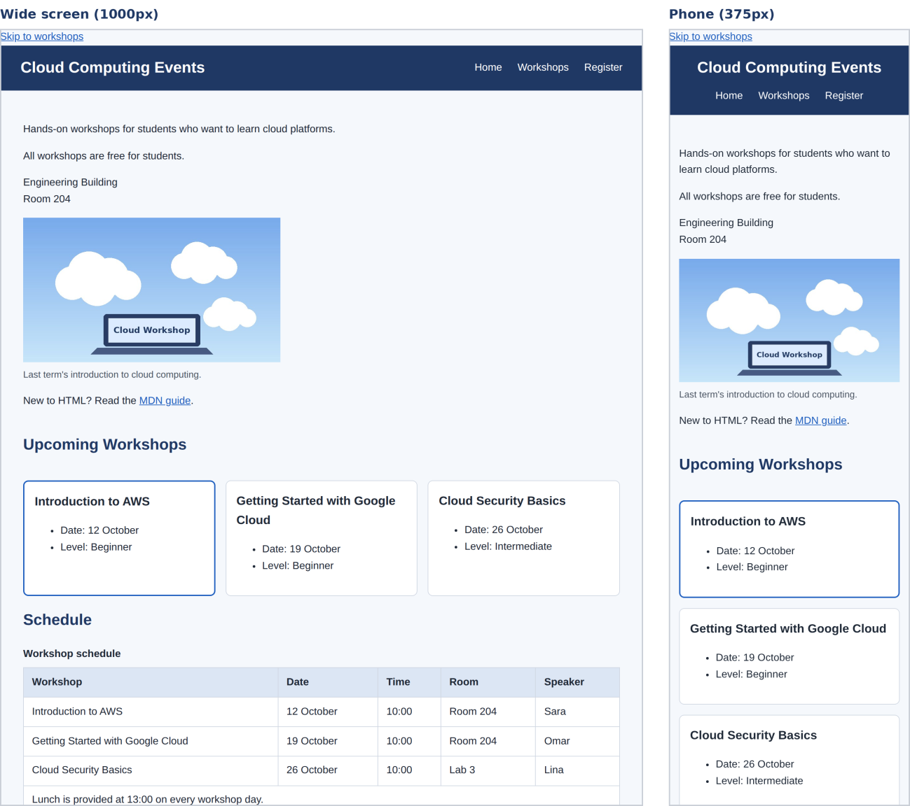
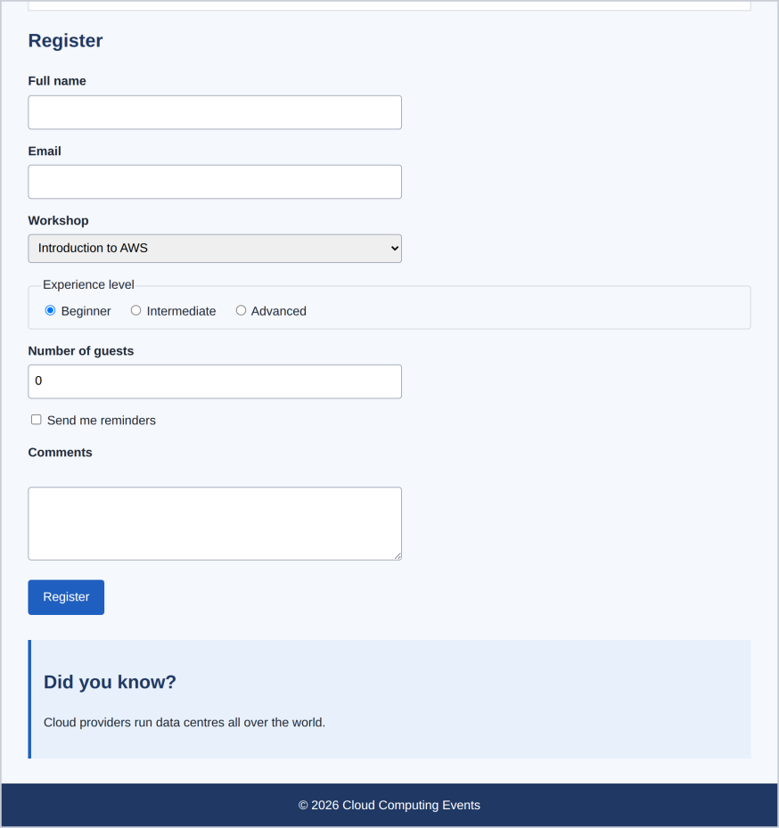

# 🏗️ Capstone · Style the Cloud Computing Events page

Time to put all nine lessons together. Use the page you built in the sequential HTML exercises (or start from [`../01-html/solution/index.html`](../01-html/solution/index.html)).

## 📋 The brief

Link a new `styles.css` and add **two class attributes** to your HTML:

- `class="workshop-grid"` on the workshops `<section>`
- `class="checkbox-row"` on the paragraph holding the reminders checkbox

### Requirements checklist

Tick each one off. The right-hand column shows where in the [reference stylesheet](solution/styles.css) you'll find it.

| ☐ | Requirement | Look for this in the reference solution |
|---|---|---|
| ☐ | One external `styles.css`, linked in the `<head>`, organised into sections with comments | The `/* ---------- Section ---------- */` comments |
| ☐ | **Base styles:** the box-sizing reset, a readable font, line height and colours with enough contrast | `* { box-sizing: border-box }` and `body { … }` |
| ☐ | A **header** with the site title on the left and a horizontal menu on the right, with no bullets and a hover state on the links | `header { display: flex … }`, `nav ul`, `nav a:hover` |
| ☐ | **Main content** centred, with a maximum width and padding | `main { max-width: 60rem; margin: 0 auto; padding … }` |
| ☐ | **Workshop articles as cards** in a three-column grid, with the featured card highlighted. The image must never overflow its container | `.workshop-grid`, `.workshop`, `.workshop.featured`, `img, video { max-width: 100% }` |
| ☐ | A **schedule table** with collapsed borders, padding and a shaded header row. *Look up `border-collapse` on MDN* | `table { border-collapse: collapse }`, `thead th { background-color }` |
| ☐ | A **form** with labels above the fields, fields with padding and a border, and a styled submit button with a hover state and a clearly visible focus outline. *Look up `border-radius`, `outline` and `cursor`* | `label { display: block }`, `input… { padding; border }`, `button`, `button:hover`, `:focus` |
| ☐ | A distinct style for the `<aside>` and the `<footer>` | `aside { border-left … }`, `footer { … }` |
| ☐ | A **responsive layout:** below 700px the cards become one column and the header stacks, and the table never breaks the page on a phone | The `@media (max-width: 700px)` block |

## 🧠 Walkthrough of the reference stylesheet

Read [`solution/styles.css`](solution/styles.css) top to bottom. Here's the *why* behind the trickier parts.

**1. Base.** `* { box-sizing: border-box }` (Lesson 4) makes every width include its padding. `body` sets font, `line-height: 1.6`, text colour and page background once, and the text properties are **inherited** by everything (Lesson 5). `img, video { max-width: 100%; height: auto }` is what stops the image overflowing its container (Lesson 9).

**2. Header + nav.** `display: flex; justify-content: space-between; align-items: center` puts title left and menu right, centred vertically (Lesson 7). The inner `nav ul` is *itself* a flex row (`gap: 1.5rem`), with `list-style: none` and zeroed margin/padding to remove bullets and the default indent.

**3. Cards in a grid.** `.workshop-grid` is a 3-column grid (Lesson 8). Its `<h2 id="workshops">` is also a grid item, so `#workshops { grid-column: 1 / -1 }` makes it span the whole row. `.workshop.featured` (two classes, no space) gets a thicker blue border.

**4. Table.** `border-collapse: collapse` merges the double borders between neighbouring cells into single lines; `th, td` get padding and a border; `thead th` gets a shaded background.

**5. Form.** `label { display: block }` puts each label above its field. Radio and checkbox labels are switched back to `display: inline` so they sit beside their buttons. Fields share one rule using a group selector plus attribute selectors (`input[type="text"], …`). `font: inherit` stops form controls using the browser's tiny default font. `cursor: pointer` on the button shows the hand cursor.

**6. Focus outline.** The `:focus` rule draws a 3px outline so keyboard users can always see where they are.

> ⚠️ **Accessibility note (my addition):** the reference solution uses an amber outline (`#f59e0b`). Against this page's pale background that is only about **2:1** contrast, below the 3:1 recommended for interface indicators. It is *visible*, but for a real project, switch to a darker colour, such as the navy `#1f3864`, which is over 10:1.

**7. Responsive.** Under 700px, the header becomes a column, the grid becomes one column, and the table gets `display: block; overflow-x: auto`, so a wide table scrolls sideways *inside itself* instead of stretching the page.

> ⚠️ **Trade-off (my addition):** `display: block` on a `<table>` can remove its table semantics for some screen readers. A common alternative is to wrap the table in a `<div>` and put `overflow-x: auto` on the wrapper. It's a good improvement to try yourself.

**Result: same HTML, two screens**



And the styled form:



## 🌟 Extra challenges (with worked answers)

**1. CSS custom properties.** Replace repeated colours with variables: define `--blue: #1f5fbf;` on `:root` and use it with `var(--blue)`.

```css
:root {
  --blue: #1f5fbf;
  --navy: #1f3864;
  --text: #1f2937;
  --page-bg: #f5f8fc;
}

a      { color: var(--blue); }
header { background-color: var(--navy); }
body   { color: var(--text); background-color: var(--page-bg); }
```
Now changing your brand colour is a one-line edit. `:root` means "the top of the document" (the `<html>` element), so the variables are available everywhere.

**2. Smooth transitions** on button and link hover states.

```css
button {
  transition: background-color 0.2s ease;
}
a {
  transition: color 0.2s ease;
}
```

**3. Zebra stripes** with `tbody tr:nth-child(even)`.

```css
tbody tr:nth-child(even) {
  background-color: #eef3fa;
}
```
`nth-child(even)` selects the 2nd, 4th, 6th… row inside the table body.

**4. A dark theme** with `@media (prefers-color-scheme: dark)`.

```css
@media (prefers-color-scheme: dark) {
  :root {
    --text: #e5e7eb;
    --page-bg: #111827;
  }
}
```
This works best together with challenge 1: redefine the variables and everything that uses them changes. Test it by switching your operating system to dark mode. (Remember to check the contrast in dark mode too, and to give cards and inputs dark backgrounds.)

**5. A sticky header** so it stays at the top while scrolling.

```css
header {
  position: sticky;
  top: 0;
}
```
The header already has a solid background, which it needs (Lesson 6).

## 🏁 Reference solution

- [`solution/index.html`](solution/index.html)
- [`solution/styles.css`](solution/styles.css)

*There is more than one correct answer. Compare structure and reasoning rather than exact values.* A placeholder picture is included at `solution/images/workshop.jpg`.

---

⬅️ [9 · Responsive design](09-responsive-design.md) · ➡️ Next: [**Common mistakes**](common-mistakes.md), then [**Chapter 3: JavaScript →**](../03-javascript/README.md)
