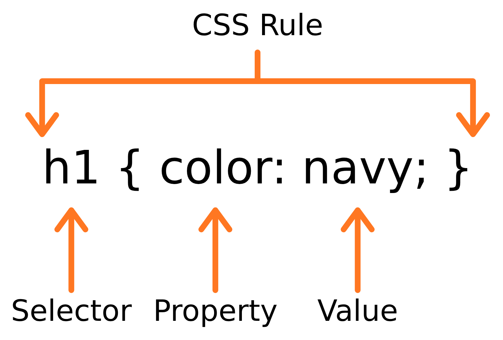

# Chapter 2 · CSS 🎨

> **CSS** (Cascading Style Sheets) tells the browser **how the content looks**: its colours, fonts, spacing and layout.

## 💡 What is CSS?

If HTML is the skeleton 🦴, CSS is the **skin, clothes and hairstyle**. HTML describes *what* the content is and how it is structured; CSS describes *how it is presented*. Change one CSS file and the whole site can look completely different — without touching a single line of HTML.

## ⚙️ How does it work?

A **stylesheet** is a **list of rules**. Each rule picks elements with a **selector** and sets **properties** on them between curly braces. The browser reads the HTML, builds the DOM tree, and then applies the rules to decide how every element is displayed.



```css
h1 {
  color: navy;
}
```

| Piece | In `h1 { color: navy; }` | Meaning |
|---|---|---|
| **Selector** | `h1` | *Which* elements to style |
| **Property** | `color` | *What* to change |
| **Value** | `navy` | *What to change it to* |
| **Declaration** | `color: navy;` | A property + value pair |

**Every declaration ends with a semicolon**, and a rule can hold as many declarations as you need:

```css
h1 {
  color: navy;
  font-size: 2rem;
  text-align: center;
}
```

## 📖 Lessons in this chapter

| # | Lesson | In one sentence |
|---|---|---|
| 1 | [Adding CSS to a page](01-adding-css.md) | Inline, internal and external (use external!) |
| 2 | [Selectors](02-selectors.md) | How to choose which elements a rule applies to |
| 3 | [Colours, text and units](03-colors-text-and-units.md) | Colour formats, fonts, `px` vs `rem` vs `%` |
| 4 | [The box model](04-the-box-model.md) | Content, padding, border, margin — and `box-sizing` |
| 5 | [The cascade: inheritance & specificity](05-the-cascade.md) | Which rule wins when several collide |
| 6 | [Display and positioning](06-display-and-positioning.md) | `block`/`inline`/`none`, and `relative`/`absolute`/`fixed`/`sticky` |
| 7 | [Flexbox](07-flexbox.md) | Layout in one direction |
| 8 | [Grid](08-grid.md) | Layout in two dimensions |
| 9 | [Responsive design](09-responsive-design.md) | Pages that adapt to phones, tablets and monitors |
| 🏗️ | [Capstone: style the whole page](10-capstone-style-the-page.md) | Requirements, extra challenges, full reference stylesheet |
| ✅ | [Common mistakes](common-mistakes.md) | Classic traps |
| 🏁 | [Reference solution](solution/) | `index.html` + `styles.css` |

## 🎒 Before you start

Use the page you built in Chapter 1 (or copy [`../01-html/solution/index.html`](../01-html/solution/index.html)). Exercises are **sequential** again — keep building on the same files.

## 🧾 Chapter cheat sheet

```css
* { box-sizing: border-box; }                 /* sane sizing everywhere */
body { font-family: Arial, sans-serif; line-height: 1.6; color: #1f2937; }
.card { padding: 1rem; border: 1px solid #d0d7e2; border-radius: 8px; }
a:hover { color: #c2410c; }                   /* pseudo-class */
header { display: flex; justify-content: space-between; align-items: center; }
.grid { display: grid; grid-template-columns: repeat(3, 1fr); gap: 1rem; }
@media (max-width: 600px) { .grid { grid-template-columns: 1fr; } }
```

Next up: [**Lesson 1 – Adding CSS to a page →**](01-adding-css.md)
