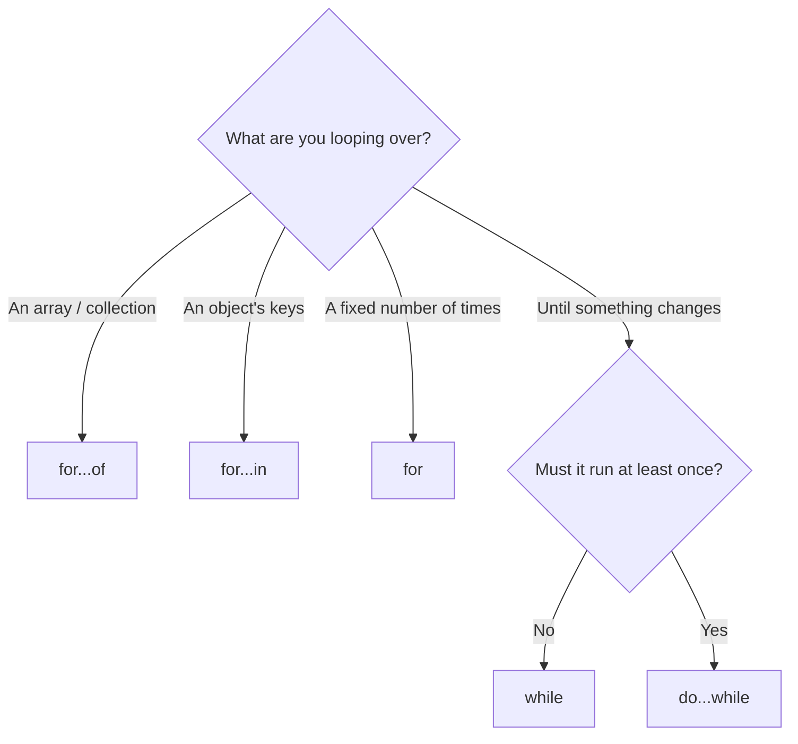

# 7 · Conditionals, loops and boolean expressions 🔀🔁

> **TL;DR:** Booleans are yes/no answers. Conditionals (`if`, ternary, `switch`) pick a path; loops repeat code.

## 💡 The big idea

This lesson has two halves:

1. **Deciding** — "*if* it's raining, take an umbrella." (booleans → `if` / ternary / `switch`)
2. **Repeating** — "*for each* guest, hand out a badge." (loops)

We'll build them up in that order: first the yes/no building blocks, then the decision tools, then the repeaters.

## 🔍 The details

### Part A · Boolean expressions

Boolean expressions **combine or compare** values and evaluate to `true` or `false`. They are mostly used in conditions such as `if` statements and loops.

```js
const a = true;
const b = false;
console.log(a && b);      // A AND B: false
console.log(a || b);      // A OR B: true
console.log(a === b);     // A equals B: false
console.log(a !== b);     // A not equals B: true
console.log(a && !b);     // A AND (NOT B): true
```

| Operator | Reads as | `true` when… |
|---|---|---|
| `&&` | AND | **both** sides are true |
| `\|\|` | OR | **at least one** side is true |
| `!` | NOT | flips true ↔ false |
| `===` / `!==` | equals / not equals | the values (and types) match / differ |
| `<`, `>`, `<=`, `>=` | comparisons | the comparison holds |

#### Loose (`==`) vs strict (`===`) equality ⚠️

```js
// Special equality operators
console.log(2 == '2');  // loose equality: converts to a shared type first, then compares: true
console.log(2 === '2'); // strict equality: compares type first, then value: false
```

**Prefer `===` and `!==` over `==` and `!=`.** Loose equality's type conversion has surprising edge cases (`0 == false` is `true`, `"" == false` is `true`), so strict equality is the safer default.

### Part B · Making decisions

#### `if`, `else if`, `else`

An `if` statement runs a block **only when** its condition is true, optionally falling through to `else if` and `else`:

```js
const age = 20;
if (age < 13) {
  console.log("Child");
} else if (age < 18) {
  console.log("Teenager");
} else {
  console.log("Adult"); // this branch runs
}
```

The checks happen **top to bottom** and the first true one wins; `else` catches everything left over.

#### The ternary operator

A compact `if/else` that **produces a value**, useful for short conditions:

```js
const isAdult = age >= 18 ? "yes" : "no";
console.log(isAdult); // yes
```

Read it as: *condition* `?` *value if true* `:` *value if false*.

#### `switch`

`switch` compares **one value against several possibilities**. Each matching `case` runs until it hits a `break`; without `break`, execution "**falls through**" into the next case, which is rarely what you want.

```js
const level = "Beginner";
switch (level) {
  case "Beginner":
    console.log("Start with the basics.");
    break;
  case "Intermediate":
    console.log("You already know the fundamentals.");
    break;
  default:
    console.log("Unknown level.");
}
```

`default` is the "none of the above" case.

| Use… | When… |
|---|---|
| `if / else if` | Conditions are different kinds of checks (ranges, combos) |
| ternary | A short either/or that produces a value |
| `switch` | One value compared against several exact options |

### Part C · Repeating things (loops)

There are five main looping constructs. (There are also *method-based* loops, such as `forEach`, but those are specific to certain object types like arrays.)

| Loop | Runs when… |
|---|---|
| `for` | You **know how many times** to loop |
| `while` | A condition holds. Checked **before** the first iteration, so the body may run **zero** times |
| `do...while` | Like `while`, but the body **always runs at least once**, since the condition is checked after |
| `for...of` | Iterating the **values** of a collection or array |
| `for...in` | Iterating the **keys** of an object |

**Which one do I pick?**



```js
for (let i = 0; i < 3; i++) {
  console.log(i); // 0, 1, 2
}

let count = 0;
while (count < 3) {
  console.log(count); // 0, 1, 2
  count++;
}

let n = 5;
do {
  console.log(n); // 5
  n++;
} while (n < 3); // condition is false, but the body already ran once

const fruits = ['apple', 'orange', 'strawberry'];
for (const fruit of fruits) {
  console.log(fruit); // apple, orange, strawberry
}

const user = { name: 'John', age: 25 };
for (const key in user) {
  console.log(`${key}: ${user[key]}`); // name: John, age: 25
}
```

The `for` header has three parts: `let i = 0` (start), `i < 3` (keep going while true), `i++` (step after each round). Forget the step in a `while` and you get an **infinite loop**.

> ⚠️ Don't use `for...in` on arrays: it gives you the *keys* (as strings `"0"`, `"1"`), not the values. Use `for...of` for arrays.

## 🛠️ Try it — Exercise 7

1. **Write an `if/else if/else` that logs `"Beginner"`, `"Intermediate"` or `"Advanced"` based on a `level` variable.**
   ```js
   const level = 2;            // 1 = beginner, 2 = intermediate, 3 = advanced
   if (level === 1) {
     console.log("Beginner");
   } else if (level === 2) {
     console.log("Intermediate");   // this branch runs
   } else {
     console.log("Advanced");
   }
   ```
2. **Rewrite it as a `switch`. Remove one `break` on purpose and see what "falls through".**
   ```js
   const level = 1;
   switch (level) {
     case 1:
       console.log("Beginner");
       // break removed on purpose
     case 2:
       console.log("Intermediate");
       break;
     default:
       console.log("Advanced");
   }
   // Beginner
   // Intermediate   ← the next case ran too, even though level isn't 2
   ```
   With the `break` restored, only `Beginner` prints.
3. **Loop over an array of workshop objects with `for...of` and log just the name of each. Then loop over one workshop object with `for...in` and log every `key: value` pair.**
   ```js
   const workshops = [
     { name: "Introduction to AWS", date: "12 October", level: "Beginner" },
     { name: "Cloud Security Basics", date: "26 October", level: "Intermediate" }
   ];
   for (const w of workshops) {
     console.log(w.name);
   }
   for (const key in workshops[0]) {
     console.log(`${key}: ${workshops[0][key]}`);
   }
   // name: Introduction to AWS
   // date: 12 October
   // level: Beginner
   ```
4. **Replace `===` with `==` in one comparison involving different types and see whether the result changes.**
   ```js
   console.log(2 === '2');  // false
   console.log(2 == '2');   // true  ← the string is silently converted to a number
   ```
   Yes, the result changes. That silent conversion is exactly the surprise to avoid.

## ⚠️ Watch out

- Using `==` and tripping over type conversion.
- Forgetting `break` in a `switch`.
- A `while` loop whose condition never becomes false.

## 📚 Go deeper

- [W3Schools – JS If Else](https://www.w3schools.com/js/js_if_else.asp) · [Loops](https://www.w3schools.com/js/js_loop_for.asp)
- [MDN – Control flow and error handling](https://developer.mozilla.org/en-US/docs/Web/JavaScript/Guide/Control_flow_and_error_handling)

---

⬅️ [6 · Arrays](06-arrays.md) · ➡️ Next: [**8 · Functions**](08-functions.md)
