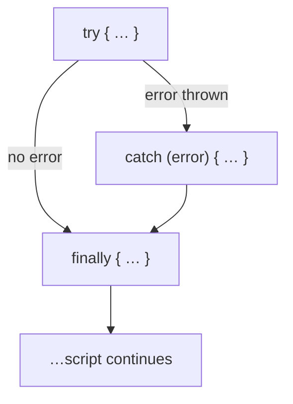

# 9 · Error handling: `try...catch` 🛟

> **TL;DR:** Put risky code in `try`. If it throws, `catch` handles it and the script carries on. `finally` always runs.

## 💡 The big idea

When an error occurs while a script is running, **execution stops at that line and the rest of the script does not run**. It's like a factory line stopping because one machine jammed.

`try...catch` is the **safety net**: it lets you handle the error so the script can keep going instead of breaking entirely.

- Code that might fail goes in `try`.
- If it throws, execution **jumps to `catch`**, which receives an **error object** with a `name` property (the type of error) and a `message` property (a description).

## 🔍 The details

```js
try {
  const data = JSON.parse("{ invalid json }"); // throws
  console.log(data);                            // never runs
} catch (error) {
  console.log(error.name); // SyntaxError
}
console.log("Script continues"); // Script continues
```

Without the `try...catch`, the `SyntaxError` would stop the whole script and "Script continues" would never print.

### `finally` and `throw`

An optional `finally` block **always runs** at the end, whether an error happened or not. It is useful for **cleanup** (hide a loading spinner, close a file…). You can also raise your own errors with `throw`.

```js
function divide(a, b) {
  if (b === 0) {
    throw new Error("Cannot divide by zero");
  }
  return a / b;
}

try {
  console.log(divide(10, 2)); // 5
  console.log(divide(10, 0)); // throws, jumps to catch
} catch (error) {
  console.log(error.message); // Cannot divide by zero
} finally {
  console.log("Done"); // Done, runs either way
}
```



### Common error names you'll meet

| `error.name` | Typical cause |
|---|---|
| `SyntaxError` | Invalid code or invalid JSON (`JSON.parse("{ invalid json }")`) |
| `TypeError` | Using a value wrongly, e.g. `null.x`, or reassigning a `const` |
| `ReferenceError` | Using a name that doesn't exist, e.g. `undefinedFn()` |

## 🛠️ Try it — Exercise 9

1. **Write a `divide` function that throws when dividing by zero, and call it inside a `try...catch`. Log `error.message`.** (The code above is the answer.) Output: `5`, then `Cannot divide by zero`.
2. **Add a `finally` block and confirm it runs both when the call succeeds and when it throws.**
   ```js
   for (const divisor of [2, 0]) {
     try {
       console.log(divide(10, divisor));
     } catch (error) {
       console.log(error.message);
     } finally {
       console.log("Done");
     }
   }
   // 5
   // Done
   // Cannot divide by zero
   // Done
   ```
   `Done` appears after **both** outcomes.
3. **Try `JSON.parse` on a string that is not valid JSON, and check `error.name`.** → `SyntaxError`. [Lesson 13](13-talking-to-a-server.md) explains why this matters for network responses: a server that answers with something other than JSON makes `response.json()` throw exactly this.

## ⚠️ Watch out

- Wrapping huge blocks of code in one `try` so you can't tell what failed.
- An empty `catch` that silently swallows errors. At minimum, `console.log` them.

## 📚 Go deeper

- [W3Schools – JS Errors](https://www.w3schools.com/js/js_errors.asp)
- [MDN – Control flow and error handling](https://developer.mozilla.org/en-US/docs/Web/JavaScript/Guide/Control_flow_and_error_handling)

---

⬅️ [8 · Functions](08-functions.md) · ➡️ Next: [**10 · The DOM**](10-the-dom.md)
