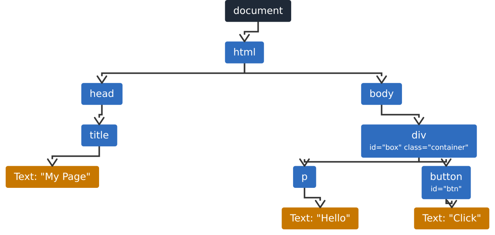

# 10 · The DOM 🌳

> **TL;DR:** The DOM is the browser's live, tree-shaped copy of your page. JavaScript reads and changes the page *through* it, using the `document` object.

## 💡 The big idea

Your HTML file is a **recipe written on paper**. Once the browser reads it, it builds the **actual dish in memory**: a tree of objects, one per element. That living tree is the **Document Object Model (DOM)**. You can't edit the paper while the guests are eating, but you *can* reach into the dish and change it, and the guests see the change instantly. That's what JavaScript does.

Any HTML page has this interface: a **tree representation of the page**, accessible through the `document` object. It is the same tree introduced in [HTML Lesson 3](../01-html/03-nesting.md), and **JavaScript is how you read and change it**.

## 🔍 The details

Here's a small page:

```html
<html>
  <head>
    <title>My Page</title>
  </head>
  <body>
    <div id="box" class="container">
       <p>Hello</p>
       <button id="btn">Click</button>
    </div>
  </body>
</html>
```

And its DOM tree:



Things worth noticing:

- The very top is the **`document`** object; `html` is its child.
- Every element is a **node**; the **text inside** an element (`"Hello"`, `"Click"`) is *also* a node (orange in the diagram).
- Attributes (`id="box"`, `class="container"`) belong to their element node.
- The family vocabulary from Chapter 1 applies: `div` is the parent of `p` and `button`, which are siblings.

### Why a tree and not just text?

Because trees are easy to **search** ("find the element with id `btn`") and **edit** ("add a new child to `div`"), and every edit can be reflected on screen immediately. [Lesson 11](11-working-with-the-dom.md) shows how.

## 🛠️ Try it — Exercise 10

1. **Open any page in your browser, right-click and choose Inspect. Compare the Elements panel tree with the diagram above.**
   The Elements panel is the DOM, drawn as indented, collapsible lines: `html` at the top, then `head` and `body` as children, with ▶ arrows to expand each branch. Expand a few. (It may include extra nodes the diagram skips, such as whitespace text nodes and elements added by scripts.)
2. **In the Console, type `document` and expand the object that prints. Then type `document.title` and `document.body`.**
   ```js
   document          // #document — expand it to see <html> inside
   document.title    // "My Page" (or whatever that tab's title is)
   document.body     // <body>…</body> — hover over it and the page highlights
   ```
   You are talking to the live tree. Try `document.body.style.background = "pink"` and watch the page change. (Refresh to undo.)

## 📚 Go deeper

- [MDN – Document Object Model (DOM)](https://developer.mozilla.org/en-US/docs/Web/API/Document_Object_Model)

---

⬅️ [9 · Error handling](09-error-handling.md) · ➡️ Next: [**11 · Working with the DOM**](11-working-with-the-dom.md)
