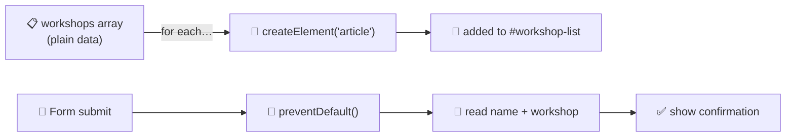
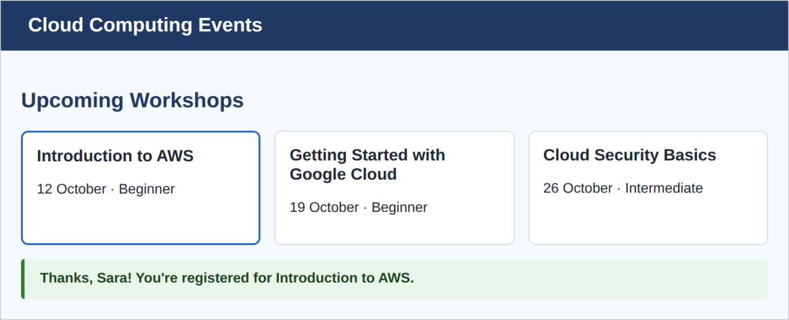

# 🏗️ Capstone · Bring the Cloud Computing Events page to life

Use the page from the HTML and CSS exercises (or start from [`../02-css/solution/`](../02-css/solution/)). Instead of **hard-coding** the three workshop `<article>` elements, you'll **build them with JavaScript from a plain data array**, and make the registration form **respond without reloading the page**.

## 🎯 What you're building



The result: three cards rendered by JavaScript, plus a friendly confirmation after registering.



## 📋 Requirements checklist

| ☐ | Requirement |
|---|---|
| ☐ | Link a new `app.js` at the end of `<body>`, **or** in `<head>` with `defer` |
| ☐ | In `app.js`, define an **array of workshop objects** (`name`, `date`, `level`, `featured`), matching the three workshops already on the page |
| ☐ | **Empty out the workshop grid** in the HTML, then use `document.createElement` and a loop (`for...of` or `.forEach`) to build one `<article>` per workshop, reading name, date and level from each object, and adding the `featured` class where it applies |
| ☐ | Add a **`submit` listener** to the registration form that calls `event.preventDefault()`, reads the **full name** and the **chosen workshop** from the form, and shows a **confirmation message** on the page instead of submitting |
| ☐ | Wrap anything that could reasonably fail (for example, parsing or reading a value you expect to exist) in `try...catch` |

### 🧩 Lesson map: where each requirement comes from

| Requirement | Lesson |
|---|---|
| Link `app.js` with `defer` | [1 · Adding JavaScript](01-adding-javascript.md) |
| Array of objects | [5 · Objects](05-objects.md), [6 · Arrays](06-arrays.md) |
| Loop + `createElement` | [7 · Loops](07-conditionals-and-loops.md), [11 · Working with the DOM](11-working-with-the-dom.md) |
| `submit` + `preventDefault` | [12 · Events](12-events.md) |
| `try...catch` | [9 · Error handling](09-error-handling.md) |

## 🧠 Reference solution, explained

> *There is more than one correct answer, so compare **structure and reasoning** rather than exact text.*

Full files: [`solution/index.html`](solution/index.html) · [`solution/app.js`](solution/app.js) · [`solution/styles.css`](solution/styles.css)

### Step 1 · The data

```js
const workshops = [
   { name: "Introduction to AWS", date: "12 October", level: "Beginner", featured: true },
   { name: "Getting Started with Google Cloud", date: "19 October", level: "Beginner", featured: false },
   { name: "Cloud Security Basics", date: "26 October", level: "Intermediate", featured: false }
];
```

Keeping the **data separate from the markup** is the big idea. To add a fourth workshop, you add one line of data and the page updates itself.

### Step 2 · Building the cards

```js
const list = document.querySelector('#workshop-list');

workshops.forEach(w => {
  const card = document.createElement('article');
  card.className = 'workshop' + (w.featured ? ' featured' : '');
  const heading = document.createElement('h3');
  heading.textContent = w.name;
  const details = document.createElement('p');
  details.textContent = `${w.date} · ${w.level}`;
  card.append(heading, details);
  list.appendChild(card);
});
```

Walk through one loop turn: create an `<article>`; set its class (a **ternary** adds `featured` only when `w.featured` is true); create an `<h3>` and a `<p>` with `textContent`; `append` both into the card; and finally `appendChild` the card into the grid. We use `textContent` (not `innerHTML`) because it's safe.

> ✏️ **HTML change you must make:** the three hard-coded `<article>` elements are removed from `index.html`, leaving just the `<h2 id="workshops">` inside `<section id="workshop-list">`. The cards in the grid now come only from JS.

### Step 3 · The form

```js
const form = document.querySelector('#register-form');
form.addEventListener('submit', (event) => {
  event.preventDefault();
  try {
    const name = document.querySelector('#fullname').value;
    const workshopSelect = document.querySelector('#workshop');
    const workshopName = workshopSelect.options[workshopSelect.selectedIndex].text;

    const confirmation = document.createElement('p');
    confirmation.className = 'confirm';
    confirmation.textContent = `Thanks, ${name}! You're registered for ${workshopName}.`;
    form.after(confirmation);
  } catch (error) {
    console.log('Could not show confirmation:', error);
  }
});
```

- `preventDefault()` stops the page reload.
- For text inputs, `.value` is what the user typed.
- For a `<select>`, `.value` is the *code* (`aws`), but we want the friendly text. `options[selectedIndex].text` reads the visible label ("Introduction to AWS").
- `form.after(confirmation)` inserts the message right below the form ([Lesson 11](11-working-with-the-dom.md)).
- Everything that touches the DOM sits in `try...catch`, so a missing element logs a message instead of breaking the page.

> ➕ **My addition:** the PDF's screenshot shows a green confirmation box, but its listed stylesheet has no rule for it. I added a small `.confirm` rule at the end of [`solution/styles.css`](solution/styles.css) to give it that look.

### ✅ I tested it

I loaded this exact solution in a simulated browser (jsdom): it builds **3 cards** (the first with the `featured` class), `preventDefault` is called, and submitting as "Sara" with "Introduction to AWS" produces `Thanks, Sara! You're registered for Introduction to AWS.`

## 🌟 Extra challenges (with worked answers)

My answers are in [`solution-extras/`](solution-extras/) (`index.html`, `app.js`, `workshops.json`, `styles.css`). I tested each one in a simulated browser.

**1. Fetch the workshops from a local `workshops.json` file** and render the cards once the data arrives.

```js
async function loadWorkshops() {
  try {
    const response = await fetch('workshops.json');
    if (!response.ok) {
      throw new Error(`Server answered ${response.status}`);   // fetch does NOT throw on 404 by itself
    }
    const workshops = await response.json();
    renderWorkshops(workshops);
  } catch (error) {
    console.log('Could not load workshops:', error);
    // show a friendly message on the page …
  }
}
loadWorkshops();
```

> ⚠️ `fetch` of a local file **doesn't work if you just double-click `index.html`** (the `file://` address is blocked for security). Serve the folder instead, e.g. with VS Code's **Live Server** extension or `npx serve` in the folder. This is a nice preview of why [Chapter 4](../04-nodejs-express-rest/README.md) exists.

**2. A "Cancel registration" button** that removes the confirmation message with `.remove()`.

```js
const cancel = document.createElement('button');
cancel.type = 'button';
cancel.textContent = 'Cancel registration';
cancel.addEventListener('click', () => confirmation.remove());
confirmation.append(text, cancel);
```
`type="button"` stops it from acting as a submit button.

**3. Validate** that a workshop is selected before showing the confirmation, and show an **inline error message (not `alert`)** if it is not.

```js
if (select.value === '') {
  errorBox.textContent = 'Please choose a workshop before registering.';
  errorBox.hidden = false;
  return;                      // stop here: no confirmation
}
errorBox.hidden = true;
```
For this to work the `<select>` needs a first "Choose a workshop…" option with `value=""`, and the page needs an empty `<p class="error" id="form-error" role="alert" hidden>`. (`role="alert"` makes screen readers announce the message.) The extras version also removes any older confirmation first, so two submits never stack two messages.

**4. An `input` listener** that live-updates a **"characters remaining"** count under the comments `<textarea>`.

```js
comments.addEventListener('input', () => {
  const left = comments.maxLength - comments.value.length;
  counter.textContent = `${left} characters remaining`;
});
```
This relies on `maxlength="200"` on the textarea and a `<p id="comment-count">` under it.

## 🏁 Reference solutions

- Main: [`solution/`](solution/)
- Extras: [`solution-extras/`](solution-extras/)

(To run either, serve the folder or double-click `solution/index.html`. The extras version needs a server for `fetch`, as explained above.)

---

⬅️ [13 · Talking to a server](13-talking-to-a-server.md) · ➡️ Next: [**Common mistakes**](common-mistakes.md), then [**Chapter 4: Node.js, Express & REST →**](../04-nodejs-express-rest/README.md)
