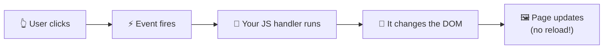

# Chapter 3 · JavaScript ⚡

> **JavaScript (JS)** is a *dynamically typed* language that runs in the browser and lets a webpage **react to what the user does**.

## 💡 What is JavaScript?

HTML gave the page its structure 🦴. CSS gave it its look 🎨. JavaScript gives it **behaviour** 🏃 — it is what turns a page from static into an actual **web application**.

**Dynamically typed** means a variable is not locked to one type: the same variable can hold a number, then later a string, without declaring a type up front. (Think of a moving box that doesn't care whether you put books or shoes in it.)

```js
let thing = 42;        // a number today…
thing = "hello";       // …a string tomorrow. JavaScript doesn't mind.
```

## ⚙️ How does it work?

The browser downloads your script, and its built-in **JavaScript engine** runs it. Scripts can read and change the DOM (the tree of elements from Chapter 1), listen for events (clicks, key presses), and talk to servers.



## 📖 Lessons in this chapter

| # | Lesson | In one sentence |
|---|---|---|
| 1 | [Adding JavaScript to a page](01-adding-javascript.md) | External, internal, inline — and `defer` |
| 2 | [Syntax and logging](02-syntax-and-logging.md) | Semicolons and the `console` |
| 3 | [Variables: `let`, `const`, `var`](03-variables.md) | Three ways to name a value |
| 4 | [Types: primitives](04-primitive-types.md) | Strings, numbers, booleans, `undefined`, `null` |
| 5 | [Objects](05-objects.md) | Key-value data |
| 6 | [Arrays](06-arrays.md) | Ordered lists and their methods |
| 7 | [Conditionals, loops and boolean expressions](07-conditionals-and-loops.md) | Making decisions and repeating things |
| 8 | [Functions](08-functions.md) | Reusable, named chunks of code |
| 9 | [Error handling: `try...catch`](09-error-handling.md) | Failing gracefully |
| 10 | [The DOM](10-the-dom.md) | The page as a tree of objects |
| 11 | [Working with the DOM](11-working-with-the-dom.md) | Finding and changing elements |
| 12 | [Events](12-events.md) | Reacting to clicks and submits |
| 13 | [Talking to a server](13-talking-to-a-server.md) | `fetch`, `async/await`, JSON and REST |
| 🏗️ | [Capstone: bring the page to life](14-capstone-bring-the-page-to-life.md) | Requirements, solution and extra challenges |
| ✅ | [Common mistakes](common-mistakes.md) | Classic traps |
| 🏁 | [Reference solution](solution/) · [extras](solution-extras/) | `index.html`, `styles.css`, `app.js` |

## 🎒 Before you start

You'll keep using the Events page from Chapters 1–2. For lessons 1–9 you can also just experiment in a scratch file (`js/app.js`) and watch the **Console** (F12).

> 💡 **Tip:** The Console can run code directly. Type `2 + 2` and press Enter. It's the best playground you have.

Next up: [**Lesson 1 – Adding JavaScript to a page →**](01-adding-javascript.md)
