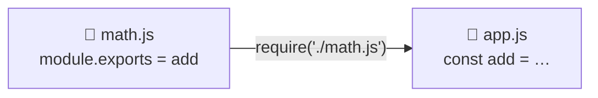

# 5 · Organizing code with modules 🗂️

> **TL;DR:** Split code across files. A file offers something with `module.exports`; another file grabs it with `require('./file.js')`.

## 💡 The big idea

Imagine one giant notebook with your whole life in it. Now imagine a **filing cabinet** with a folder per topic. That's modules. Node.js encourages splitting code across multiple files, called **modules**, instead of writing everything in one place.

A value is made available to other files with **`module.exports`**, and pulled into another file with **`require()`**.

## 🔍 The details

```js
// math.js
function add(a, b) {
  return a + b;
}

module.exports = add;
```

```js
// app.js
const add = require('./math.js');

console.log(add(2, 3)); // output: 5
```

```
node app.js
5
```



> **The `./` before the file name tells Node.js this is a local file rather than an installed package.**
> - `require('./math.js')` → look for **my** file `math.js` next to this one.
> - `require('express')` → look for an **installed package** called `express` in `node_modules`.

Forget the `./` and Node goes hunting for a package: `Error: Cannot find module 'math.js'`.

Runnable copy: [`examples/03-modules/`](examples/03-modules/) (`node app.js`).

You'll see this pattern again in the MongoDB lesson: `models/User.js` ends with `module.exports = …` and `server.js` begins with `require('./models/User')`.

## 🛠️ Try it

1. Create `math.js` and `app.js` as above and run `node app.js`.
2. Remove the `./` and read the error.
3. Add a second function (e.g. `subtract`) and export both. *(Hint: `module.exports = { add, subtract };` and `const { add, subtract } = require('./math.js');`.)*

---

⬅️ [4 · npm and packages](04-npm-and-packages.md) · ➡️ Next: [**6 · Creating a web server**](06-creating-a-web-server.md)
