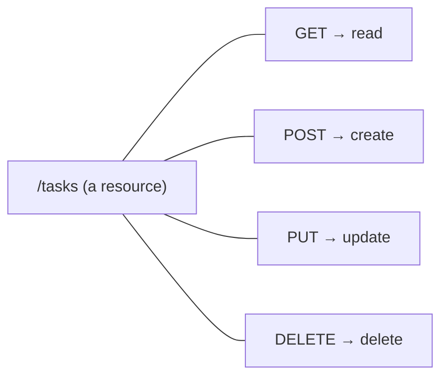

# 8 · What is a REST API? 🧭

> **TL;DR:** An API lets one program ask another to do something. A REST API follows HTTP conventions: **URLs name things (resources); methods say what to do with them.**

## 💡 The big idea

An **API** (Application Programming Interface) is a way for **one program to ask another program** to do something or return data. Think of a **restaurant menu**: you don't walk into the kitchen; you order from a defined list, and the kitchen returns exactly what that item promises.

A **REST API** is an API that follows a common set of conventions built on top of **HTTP**, the protocol the web already uses.

In a REST API:

- Data is organised into **resources** (for example, "users" or "products"), and each resource has a **URL**.
- **What action is performed** on that resource is decided by the **HTTP method** used in the request, **not by the URL itself**.

So you don't have `/getUsers`, `/createUser`, `/deleteUser`. You have **one URL, `/users`**, and the verb tells the story.

## 🔍 The details

For a resource called `/users`:

| Request | Action |
|---|---|
| `GET /users` | Get the list of all users |
| `GET /users/1` | Get the user with id 1 |
| `POST /users` | Create a new user |
| `PUT /users/1` | Update the user with id 1 |
| `DELETE /users/1` | Delete the user with id 1 |

These four verbs map onto the classic four things you do with data (often called **CRUD**):

| CRUD | Meaning | HTTP method |
|---|---|---|
| **C**reate | Make something new | `POST` |
| **R**ead | Look at something | `GET` |
| **U**pdate | Change something | `PUT` |
| **D**elete | Remove something | `DELETE` |

Notice how the URL stays tidy and **nouns** (`/tasks`), while the **method** acts like the verb. That is the heart of REST. The Tasks API in [Lesson 10](10-building-a-rest-api.md) follows this exact table.

## 🛠️ Try it

Without writing any code, translate each sentence into a REST request:

1. "Show me all products." → `GET /products`
2. "Delete product 7." → `DELETE /products/7`
3. "Add a new product." → `POST /products`
4. "Change the price of product 7." → `PUT /products/7`

---

⬅️ [7 · Introducing Express](07-introducing-express.md) · ➡️ Next: [**9 · The request/response flow**](09-request-response-flow.md)
