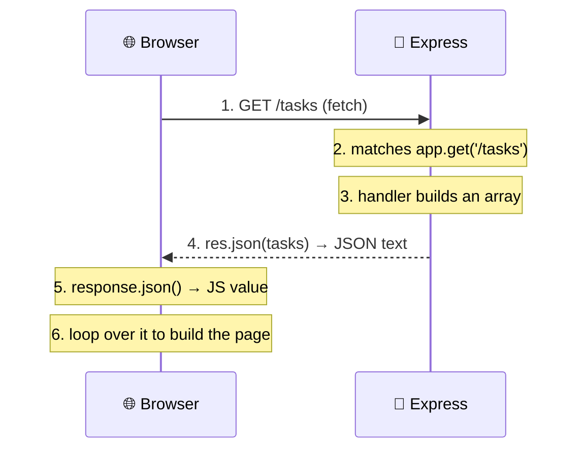
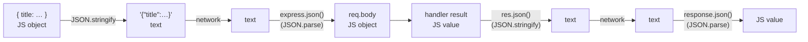

# 9 · From browser to server and back: the request/response flow 🔄

> **TL;DR:** A page's JavaScript calls `fetch`, Express matches a route, the handler builds a result, and JSON carries it back. Data is converted to JSON text on the way out and back to objects on the way in, **twice per round trip**.

## 💡 The big idea

So far, requests have been triggered from a browser's address bar or with `curl`. In a real application, requests are usually triggered by a **webpage's own JavaScript**, using `fetch()`. Walking through **one complete request, end to end**, ties together everything covered so far.

The key insight: **only text can travel over a network.** A real JavaScript object can't be sent as-is, so it gets turned into text (JSON) before sending and rebuilt into an object after arriving, like **flat-pack furniture**: disassembled for the trip, reassembled at the destination.

## 🔍 The details

### Reading data: a GET request

```js
fetch('http://localhost:3000/tasks')
  .then(response => response.json())
  .then(data => console.log(data));
```

(This uses `.then()` chaining, an older style of the same thing `async/await` does. The equivalent is:
`const response = await fetch(...); const data = await response.json();`.)



1. The browser runs `fetch(...)`, which sends an HTTP **GET** request to `http://localhost:3000/tasks`.
2. Express **receives** the request and **matches** it to the route defined with `app.get('/tasks', ...)`.
3. The **route handler** runs on the server and builds a plain JavaScript value, for example an array of tasks.
4. `res.json(tasks)` converts that value into a JSON string, using `JSON.stringify()` internally, and sends it back as the response body.
5. Back in the browser, `response.json()` reads that response body and converts the JSON text back into a JavaScript value, using `JSON.parse()` internally. This is exactly what `JSON.parse()` does when called directly; `response.json()` simply does it for you.
6. The result is a **normal JavaScript array** again, ready to update the page, for example looping over it to build a visible list.

### Sending data: a POST request

Sending data works the same way, in reverse, and this is where the JSON conversion becomes **visible in the code itself**:

```js
fetch('http://localhost:3000/tasks', {
   method: 'POST',
   headers: { 'Content-Type': 'application/json' },
   body: JSON.stringify({ title: 'Write documentation' })
})
   .then(response => response.json())
   .then(data => console.log(data));
```

A request body can only ever contain **text**. `JSON.stringify({ title: ... })` converts the object into JSON text first, so it is safe to send. On the server side, `app.use(express.json())` reverses this automatically: it runs `JSON.parse()` on the incoming text and places the result in `req.body`, ready to use as a normal JavaScript object.

### Where JSON fits into every request

A single POST request like the one above **crosses the JSON boundary twice**: once on the way in, once on the way out. Here is that same request, with each JSON conversion labelled:

| Step | Who | What happens |
|---|---|---|
| 1 | **Browser** | `JSON.stringify({ title: ... })` turns the object into text |
| 2 | **Network** | The text travels to the server as the request body |
| 3 | **Express** | `express.json()` runs `JSON.parse()` on it, filling `req.body` |
| 4 | **Server** | The route handler builds a plain JavaScript result value |
| 5 | **Express** | `res.json(value)` runs `JSON.stringify()` on it before sending |
| 6 | **Browser** | `response.json()` runs `JSON.parse()` on it, giving usable data |



### Two handy details about `stringify` and `parse`

- `JSON.stringify(value, null, 2)` **adds indentation**, which is useful for printing readable JSON while debugging.
- `JSON.parse()` **throws an error if the text it receives is not valid JSON**, so it is often wrapped in a `try...catch` block when the input is not guaranteed to be well-formed.

```js
console.log(JSON.stringify({ id: 1, title: 'Learn Node.js' }, null, 2));
// {
//   "id": 1,
//   "title": "Learn Node.js"
// }
```

## 🛠️ Try it

With the Tasks API from [Lesson 10](10-building-a-rest-api.md) running, open any web page's DevTools Console (or a small HTML file served from the same server) and run the two `fetch` snippets above. Watch the **Network** tab: you can see the request, its method, its JSON body, the status code and the JSON response.

> ⚠️ Calling `http://localhost:3000` from a page served from a **different** address (a different port counts!) is blocked by the browser's cross-origin rule (CORS). The signup example in [Lesson 11](11-mongodb-and-mongoose.md) avoids this by serving its page from the same Express server. See also [Concepts worth exploring](../resources/concepts-worth-exploring.md).

---

⬅️ [8 · What is a REST API?](08-what-is-a-rest-api.md) · ➡️ Next: [**10 · Building a REST API in Express**](10-building-a-rest-api.md)
