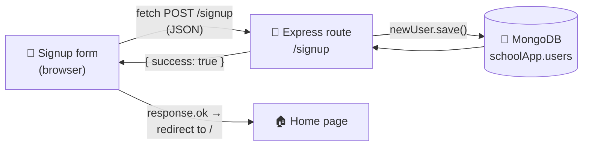

# 11 · MongoDB and Mongoose 🥫

> **TL;DR:** Arrays in memory vanish when the server restarts. A database keeps data permanently. MongoDB stores JSON-like documents; Mongoose describes their shape and saves them from Node.

## 💡 The big idea

Everything so far has been stored in a plain array that **disappears every time the server restarts**. Real applications store their data in a **database** instead.

Think of the difference between **a whiteboard** (fast, but wiped when you leave the room) and **a filing cabinet** (still there tomorrow). The array was the whiteboard; MongoDB is the filing cabinet.

This lesson walks through the smallest possible full-stack example: a **signup form** filled in on a webpage, sent to Node.js with `fetch`, **saved into a local MongoDB database**, and then **redirected to the home page** once it succeeds.



## 🔍 The details

### MongoDB and Mongoose

**MongoDB** is a database that stores data as **documents** — objects that look very similar to JSON — rather than the rows and columns used by older (relational) databases.

| Relational database | MongoDB |
|---|---|
| Table | **Collection** |
| Row | **Document** (a JSON-like object) |
| Column | Field |

This section assumes **MongoDB is already installed and running locally**, at its default address, `mongodb://127.0.0.1:27017`.

**Mongoose** is an npm package that makes it much easier to work with MongoDB from Node.js, by **describing the shape data must have before it is allowed to be saved**.

```bash
npm install mongoose
```

### Connecting to the database

```js
const mongoose = require('mongoose');

mongoose.connect('mongodb://127.0.0.1:27017/schoolApp');

console.log('Connecting to MongoDB...');
```

The address given to `mongoose.connect()` points at the local database server, followed by a **database name** (`schoolApp` here). **MongoDB creates that database automatically the first time something is saved to it** — it does not need to be created by hand first.

(`127.0.0.1` is another name for "this computer", the same as `localhost`. `27017` is MongoDB's default port.)

### Defining a model

A **model** is a blueprint that describes what a piece of data should look like before Mongoose is allowed to save it. It is built from a **schema**, which lists each field and its type.

```js
// models/User.js
const mongoose = require('mongoose');

const userSchema = new mongoose.Schema({
  name: String,
  email: String
});

module.exports = mongoose.model('User', userSchema);
```

The schema says every user has a `name` and an `email`, both text. `mongoose.model('User', userSchema)` turns that schema into a usable model named `User`, connected to a **`users` collection** in the database, and `module.exports` makes it available to any file that `require()`s it ([Lesson 5](05-modules.md)).

### The signup route

```js
const User = require('./models/User');

app.post('/signup', async (req, res) => {
  try {
    const newUser = new User({
      name: req.body.name,
      email: req.body.email
    });

    await newUser.save();
    res.json({ success: true });
  } catch (error) {
    res.status(500).json({ error: 'Could not create the user' });
  }
});
```

- `new User({...})` creates a **document in memory** that follows the shape defined by the schema.
- `newUser.save()` is what **actually writes it to MongoDB** — and since talking to a database happens over a network, the route is marked `async` so that `await` can pause it until the save finishes ([JS Lesson 13](../03-javascript/13-talking-to-a-server.md)).
- The `try...catch` matters here: a save can fail, for example if the database is unreachable, so the route **reports a clear error** instead of leaving the request hanging or crashing the server.
- Once saved, the server replies with a small confirmation object; **deciding what happens next is left to the frontend.**

### The form and the `fetch` request

On the page itself, a plain HTML form collects the two fields, and JavaScript intercepts its submission to send the data with `fetch` instead of letting the browser reload the page:

```html
<form id="signupForm">
  <input type="text" id="name" placeholder="Name" />
  <input type="email" id="email" placeholder="Email" />
  <button type="submit">Sign Up</button>
</form>
```

```js
document.querySelector('#signupForm').addEventListener('submit', async (event) => {
  event.preventDefault(); // stop the browser from reloading the page

  const name = document.querySelector('#name').value;
  const email = document.querySelector('#email').value;

  const response = await fetch('http://localhost:3000/signup', {
    method: 'POST',
    headers: { 'Content-Type': 'application/json' },
    body: JSON.stringify({ name, email })
  });

  if (response.ok) {
    window.location.href = '/'; // redirect to the home page
  }
});
```

`event.preventDefault()` stops the form's normal full-page reload. The two field values are read, turned into JSON with `JSON.stringify()`, and sent to `/signup`. `response.ok` is `true` when the server answered with a successful status code, and `window.location.href` changes the page the browser is showing — this is what performs the **redirect** once the save is confirmed.

(`{ name, email }` is shorthand for `{ name: name, email: email }`.)

### The full flow

1. The user fills in the form and clicks "Sign Up".
2. The `submit` event listener intercepts it and prevents the default page reload.
3. `fetch` sends the two fields as JSON to `POST /signup`.
4. `express.json()` parses the request body into `req.body`.
5. The route creates a new `User` document and saves it to MongoDB.
6. The server responds with `{ success: true }`.
7. The frontend checks `response.ok` and redirects the browser to the home page.

## 🧪 Run it yourself (my assembled version)

The source shows this example in pieces, so I assembled the pieces into one runnable project: [`examples/07-signup-mongodb/`](examples/07-signup-mongodb/).

```
07-signup-mongodb/
├── models/User.js       ← the schema/model
├── server.js            ← Express + Mongoose + the /signup route
└── public/
    ├── signup.html      ← the form + fetch script
    └── index.html       ← the "home page" you get redirected to
```

```bash
cd examples/07-signup-mongodb
npm install
node server.js          # with MongoDB running locally
```

Then open **http://localhost:3000/signup.html**, sign up, and you should land on the home page. To confirm the data was saved, use MongoDB's shell:

```
mongosh
> use schoolApp
> db.users.find()
```

**Why the pages are served by the same server:** `server.js` includes `app.use(express.static('public'))`, which serves the files in `public/` directly. That way the page and the API share one address (`localhost:3000`). If you instead open `signup.html` from your disk, or from a different local server such as VS Code's Live Server on another port, the browser will block the `fetch` with a **CORS** error. See [Concepts worth exploring](../resources/concepts-worth-exploring.md) for what CORS is.

### ✅ What I tested, and what I couldn't

I had no MongoDB available where I built this, so I could **not** run it against a real database. What I *did* test, with the database call replaced by a stand-in:

| Check | Result |
|---|---|
| `POST /signup` with a name and email | `200 { success: true }` and the `User` was created with the right fields |
| `POST /signup` when saving fails | `500 { error: 'Could not create the user' }` (the `catch` path) |
| Connection failure at start-up | The server logs `Could not connect to MongoDB: …` and **stays alive**. (That `.catch` is my addition, so an unreachable database doesn't crash start-up.) |
| `GET /` and `GET /signup.html` | Both served (200) from `public/` |

Please run it against your own MongoDB to see the complete flow.

## 🛠️ Try it

1. Make sure MongoDB is running, then start the signup example and sign up with your own name and email.
2. Check the data in `mongosh` as above. Stop and restart the Node server: **the user is still there.** That's the whole point.
3. Stop MongoDB and try signing up. What happens? (The route's `catch` returns a 500, the frontend's `response.ok` is `false`, so no redirect happens, and the user stays on the form. A friendly improvement: show an error message when `response.ok` is false.)

## ⚠️ Watch out

- Trying to connect before MongoDB is running, or a typo in the connection string or database name.
- Forgetting `async`/`await` around `save()`.

## 📚 Go deeper

- [Mongoose — official documentation](https://mongoosejs.com/docs/)

---

⬅️ [10 · Building a REST API](10-building-a-rest-api.md) · ➡️ Next: [**12 · Testing the API**](12-testing-the-api.md)
