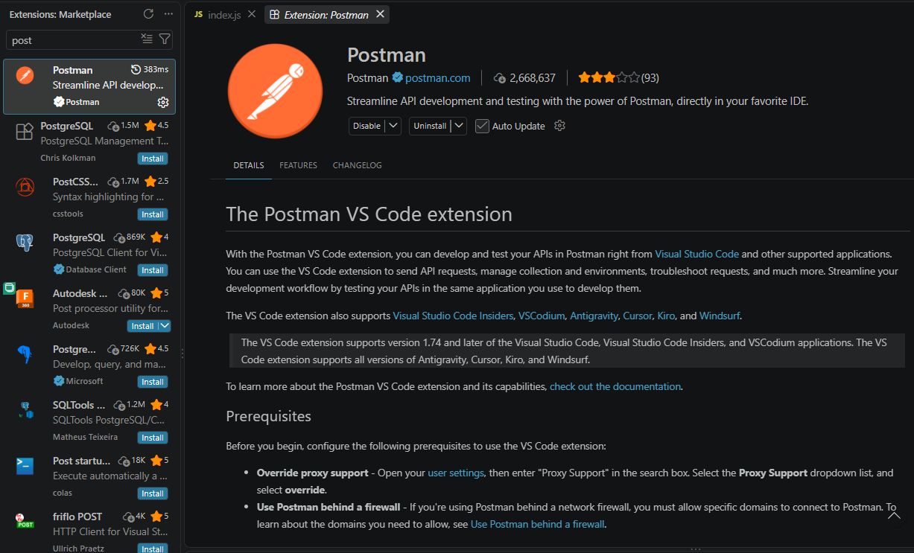
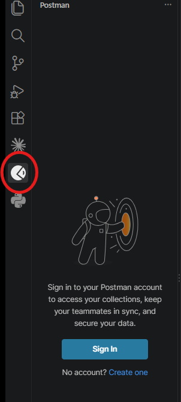
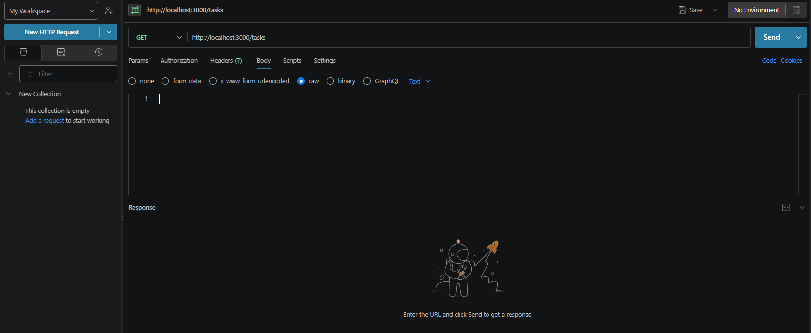

# 12 · Testing the API 🧪

> **TL;DR:** A browser can only send GET requests from its address bar, so use **Postman** (visual) or **curl** (command line) to test POST, PUT and DELETE.

## 💡 The big idea

Since this API is **not a web page**, it cannot be tested by simply opening it in a browser — a browser can only send `GET` requests by default. To test the other verbs you need a tool that can send **any** request and show you the response, like a **test remote control** for your server.

There are two common ways.

## 🔍 The details

### Option 1 · Postman 📮

**Postman** is a free application with a visual interface for sending requests and viewing responses. It is available as a **desktop app**, or as a **VS Code extension**:

1. **Search for "Postman" in the Extensions tab and install it.**

   

2. **Click the Postman icon after installing, and sign in (or create a free account).**

   

3. **Click New HTTP Request and fill in the request:** choose the **method** (GET, POST, and so on), enter the **URL**, and, for a POST or PUT request, switch the **body** to **raw** and enter JSON.

   

**A worked example (POST):**

| Field | Value |
|---|---|
| Method | `POST` |
| URL | `http://localhost:3000/tasks` |
| Body → raw → JSON | `{ "title": "Write documentation" }` |

Press **Send** and the response panel shows the status (`201 Created`) and the new task.

> 💡 When you choose **raw → JSON** Postman sets the `Content-Type: application/json` header for you. If you pick "Text" instead, you'll hit the "missing Content-Type" mistake below.

### Option 2 · curl 💻

**curl** is a simple command-line tool, well suited to **quick GET or DELETE checks**:

```bash
curl http://localhost:3000/tasks

curl -X DELETE http://localhost:3000/tasks/1
```

Testing a POST or PUT request means sending a **JSON body** along with it, which is far easier to fill in visually with Postman than to type by hand in a terminal — so **Postman is the better tool for those two.**

That said, curl *can* do it. These are the commands I used to test the Tasks API:

```bash
# macOS / Linux / Git Bash
curl -X POST -H "Content-Type: application/json" \
     -d '{"title":"Write documentation"}' http://localhost:3000/tasks

curl -X PUT -H "Content-Type: application/json" \
     -d '{"done":true}' http://localhost:3000/tasks/1
```

> 🪟 **Windows PowerShell tip:** `curl` there is an alias for a different command. Use `curl.exe` instead, and escape the JSON quotes (`'{\"title\":\"Write documentation\"}'`), or just use Postman.

### Which one when?

| | Postman | curl |
|---|---|---|
| Quick GET / DELETE | ✅ | ✅ (fastest) |
| POST / PUT with JSON | ✅ **easiest** | Possible, fiddly |
| Saves requests for later | ✅ (Collections) | ❌ |
| Needs installing/sign-in | Yes | Usually pre-installed |

### What to check in every response

1. **Status code** – is it what you expected (200 / 201 / 204 / 404)?
2. **Body** – is the JSON shaped right?
3. **Headers** – is `Content-Type` `application/json`?
4. **Server terminal** – any errors logged there?

## 🛠️ Try it

Start the Tasks API from [Lesson 10](10-building-a-rest-api.md) and test every route:

| # | Request | Expect |
|---|---|---|
| 1 | `GET /tasks` | `200` and an array |
| 2 | `GET /tasks/1` | `200` and one task |
| 3 | `GET /tasks/99` | `404` and `{"error":"Task not found"}` |
| 4 | `POST /tasks` with a title | `201` and the new task with an `id` |
| 5 | `PUT /tasks/1` with `{"done": true}` | `200` and the updated task |
| 6 | `DELETE /tasks/2` | `204` and no body |
| 7 | `GET /tasks` again | The list reflects steps 4–6 |
| 8 | `POST /tasks` **without** the JSON header | A `500` error page: the server logs `Cannot read properties of undefined (reading 'title')` |

(Rows 1–7 are the real results I got when I ran it.)

---

⬅️ [11 · MongoDB and Mongoose](11-mongodb-and-mongoose.md) · ➡️ Next: [**Common mistakes**](common-mistakes.md)
