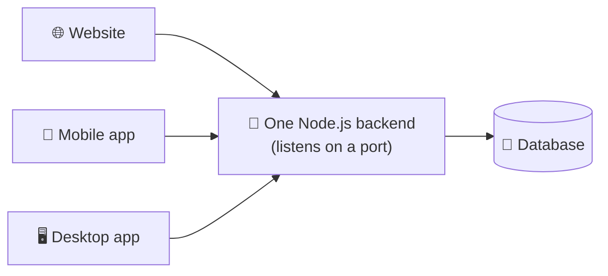

# Chapter 4 · Node.js, Express & REST API 🍳

> **Node.js** lets JavaScript run **outside a browser**, directly on a computer, the same way a program written in Python or Java would.

## 💡 What is Node.js?

Until now, your JavaScript lived inside a web page. Node.js takes the same language out of the browser and onto your computer. It uses the same engine that powers Google Chrome (**V8**), so the **language itself does not change**. What changes is what surrounds it: Node.js adds capabilities a browser deliberately blocks, such as **reading and writing files, creating a web server, and connecting to a database**.

This is what turns JavaScript from a browser-only language into a **general-purpose** one, capable of building servers, small tools and full backend applications.

> 🍽️ **Restaurant analogy, continued:** Chapters 1–3 built the *dining room* (what customers see and touch). This chapter builds the **kitchen**: a place that receives orders (requests), prepares them, and sends plates back (responses).

Once such a server is running, it simply **listens for requests on a network address**. It has no idea, and does not care, what kind of program sent them. A website's frontend, a mobile app, or a desktop app can **all talk to the same Node.js backend**, as long as each one can send it an HTTP request and read back the response.

### Why is it popular?

- **Same language (JavaScript) on both the frontend and the backend.** You learn one language, not two.
- **A large ecosystem of free packages through npm** (Node Package Manager).

## 📖 Lessons in this chapter

| # | Lesson | In one sentence |
|---|---|---|
| 1 | [Installing Node.js](01-installing-node.md) | Get `node` and `npm` and check they work |
| 2 | [Running JavaScript with Node](02-running-javascript-with-node.md) | The REPL, and running a file |
| 3 | [What Node.js adds to JavaScript](03-what-node-adds.md) | `fs`, `path`, `process`, `http` |
| 4 | [npm and packages](04-npm-and-packages.md) | `package.json`, `npm init`, `npm install` |
| 5 | [Organizing code with modules](05-modules.md) | `module.exports` and `require` |
| 6 | [Creating a web server](06-creating-a-web-server.md) | Your first server, and why manual routing hurts |
| 7 | [Introducing Express](07-introducing-express.md) | Routing made pleasant |
| 8 | [What is a REST API?](08-what-is-a-rest-api.md) | Resources, URLs and methods |
| 9 | [The request/response flow](09-request-response-flow.md) | One request, end to end, and where JSON converts |
| 10 | [Building a REST API in Express](10-building-a-rest-api.md) | A complete Tasks API |
| 11 | [MongoDB and Mongoose](11-mongodb-and-mongoose.md) | Saving data permanently: a signup example |
| 12 | [Testing the API](12-testing-the-api.md) | Postman and curl |
| ✅ | [Common mistakes](common-mistakes.md) | Classic traps (with real error messages) |
| 🧪 | [`examples/`](examples/) | Seven runnable mini-projects |

## 🧪 Runnable examples

Every code listing in this chapter has a runnable home in [`examples/`](examples/):

| Folder | What it shows |
|---|---|
| [`01-hello-node`](examples/01-hello-node/) | `node app.js` |
| [`02-built-in-modules`](examples/02-built-in-modules/) | `fs`, `path`, `process` |
| [`03-modules`](examples/03-modules/) | `module.exports` / `require` |
| [`04-http-server`](examples/04-http-server/) | Hello server + manual routing |
| [`05-express-routes`](examples/05-express-routes/) | The same routes with Express |
| [`06-tasks-api`](examples/06-tasks-api/) | The complete in-memory REST API |
| [`07-signup-mongodb`](examples/07-signup-mongodb/) | Signup form → Express → MongoDB |

To run any Express example: `cd` into the folder, then `npm install` and `node server.js`.

Next up: [**Lesson 1 – Installing Node.js →**](01-installing-node.md)
