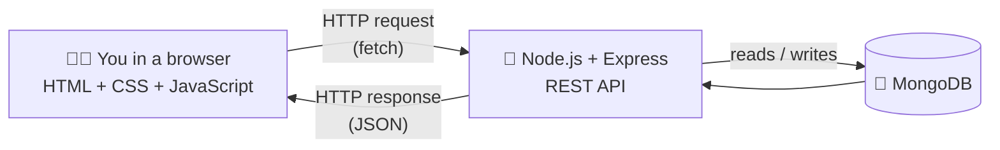
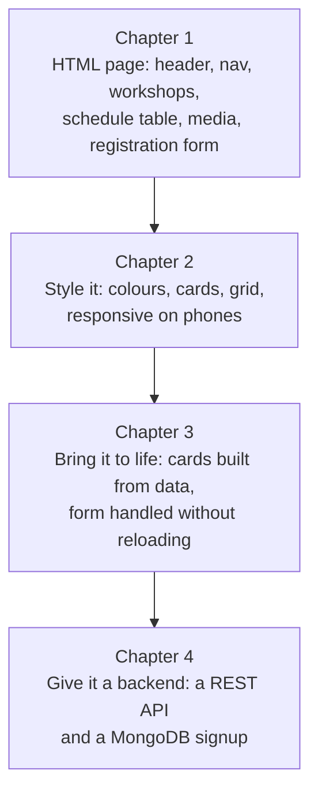

# ☁️ The Cloud Computing Full-Stack Handbook

**HTML • CSS • JavaScript • Node.js — explained like a friend is sitting next to you.**

This repository is a complete, beginner-friendly rebuild of the *Full Stack Development – Supporting Material Pack* (93 pages, HTML → CSS → JavaScript → Node.js/Express/REST/MongoDB). Every concept, table, code sample, exercise, "common mistake", link and "concept worth exploring" from the original is here, but re-told in plain language with analogies, "what you should see" walkthroughs, and working code you can run.

> 🎯 **Goal:** by the end you will have built a real (small) full-stack app: a web page you designed, styled and made interactive, talking to a server you wrote yourself.

---

## 🍰 The big picture in 60 seconds

Imagine a restaurant:

| Layer | Restaurant analogy | Technology | What it does |
|---|---|---|---|
| **Structure** | The building: walls, tables, doors | **HTML** | Says *what* things are (a heading, a button, a form) |
| **Presentation** | The decor: colours, lighting, layout | **CSS** | Says *how* things look |
| **Behaviour** | The waiters who react to you | **JavaScript** | Makes the page *do* things |
| **The kitchen** | Where orders are received and prepared | **Node.js + Express** | A server that receives requests and answers them |
| **The pantry** | Where ingredients are kept safely | **MongoDB** | A database that remembers data after the power goes off |



---

## 🗺️ Your learning path

Follow the chapters **in order**. The exercises are *sequential*: each one builds on the page you made in the previous one.

| # | Chapter | You will learn | Sections |
|---|---|---|---|
| 1 | [**HTML**](01-html/README.md) | Elements, attributes, nesting, semantic tags, forms, tables, media, linking CSS/JS | 7 |
| 2 | [**CSS**](02-css/README.md) | Selectors, colours & units, the box model, the cascade, Flexbox, Grid, responsive design | 9 + capstone |
| 3 | [**JavaScript**](03-javascript/README.md) | Variables, types, objects, arrays, control flow, functions, errors, the DOM, events, `fetch`/`async`/JSON/REST | 13 + capstone |
| 4 | [**Node.js, Express & REST**](04-nodejs-express-rest/README.md) | Running JS outside the browser, npm, modules, servers, Express, REST APIs, MongoDB & Mongoose, testing | 12 |

Extras:

- 📖 [**Glossary**](GLOSSARY.md) – every term in one place, in plain English
- 🔗 [**Useful links**](resources/useful-links.md) – every link from the original, organised by chapter
- 🧭 [**Concepts worth exploring**](resources/concepts-worth-exploring.md) – a friendly primer on every "what to learn next" topic from the original
- 🧾 [**Cheat sheet**](resources/cheat-sheet.md) – the whole course on a few screens

---

## 🏗️ The project you'll build: **Cloud Computing Events**

A small website for a fictional series of cloud workshops. You build it *layer by layer*:



Each chapter has a `solution/` folder with the finished result *of that chapter*, so you can compare your work (there's always more than one correct answer — compare **structure and reasoning**, not exact text).

<p align="center">
  <br>
  <em>The finished page from Chapter 2, on a desktop screen and on a phone.</em>
</p>

---

## 🧰 What you need before you start

- A **text editor** – [VS Code](https://code.visualstudio.com/) is a great free choice (the PDF also uses its Postman extension in Chapter 4).
- A modern **browser** with **DevTools** (Chrome, Edge, Firefox…). Press **F12** to open it. You'll use it *constantly*.
- **Node.js** (Chapter 4 only) – you'll install it from [nodejs.org](https://nodejs.org/).
- **MongoDB** running locally (only for the last example in Chapter 4).
- Curiosity. That's it. 💛

---

## 📂 Repository map

```
cloud-computing-fullstack-handbook/
├── README.md                     ← you are here
├── GLOSSARY.md
├── assets/                       ← diagrams & screenshots (taken from the original PDF)
├── 01-html/
│   ├── README.md                 ← chapter intro
│   ├── 01-elements.md … 07-connecting-html-css-js.md
│   ├── common-mistakes.md
│   └── solution/                 ← finished HTML page
├── 02-css/
│   ├── README.md
│   ├── 01-adding-css.md … 09-responsive-design.md
│   ├── 10-capstone-style-the-page.md
│   ├── common-mistakes.md
│   └── solution/                 ← HTML + styles.css
├── 03-javascript/
│   ├── README.md
│   ├── 01-adding-javascript.md … 13-talking-to-a-server.md
│   ├── 14-capstone-bring-the-page-to-life.md
│   ├── common-mistakes.md
│   ├── solution/                 ← HTML + CSS + app.js
│   └── solution-extras/          ← my worked answers to the "Extra Challenges"
├── 04-nodejs-express-rest/
│   ├── README.md
│   ├── 01-installing-node.md … 12-testing-the-api.md
│   ├── common-mistakes.md
│   └── examples/                 ← 7 runnable mini-projects
└── resources/
    ├── useful-links.md
    ├── concepts-worth-exploring.md
    └── cheat-sheet.md
```

---

## 🧭 How to use each lesson

Every lesson follows the same rhythm so you always know where you are:

1. **💡 The big idea** – one plain-English paragraph (often with an analogy).
2. **🔍 The details** – the full explanation, tables, and code.
3. **🛠️ Try it** – the exercises from the original, each with *what to do*, *what you should see*, and *why*.
4. **⚠️ Watch out** – the classic traps.
5. **📚 Go deeper** – links to the best docs.

**Golden rules for learning this stuff:**

- ⌨️ **Type the code yourself.** Copy-pasting teaches your clipboard, not your brain.
- 💥 **Break things on purpose.** Several exercises ask you to. Errors are how you learn what the machine is actually doing.
- 🔎 **Use DevTools all the time.** Elements panel, Console, Network, Styles pane — they show you the truth.
- 🐢 **Refresh after every small change.** Tiny steps = tiny bugs.

---

## ✅ A note on accuracy and testing

- The content follows the original PDF section by section. Where I added something (extra explanations, the assembled signup server, worked answers to the "Extra Challenges", placeholder image), it is labelled as an **addition**.
- I ran the code: the Chapter 3 solutions in a simulated browser (jsdom), and the Chapter 4 servers with real HTTP requests. The one thing I could **not** run end-to-end is the MongoDB example against a real database (none was available in my environment) — its route logic was tested with the database stubbed out. Run it locally against your own MongoDB to see the full flow.
- Screenshots and diagrams in `assets/` come from the original PDF.
- Every external link in the lessons is one of the PDF's own links (all 84 are in [Useful links](resources/useful-links.md)), except the two official homepages `nodejs.org` and `code.visualstudio.com`.
- I did not click the external links to check that they are still live. I did validate all 15 diagrams with the Mermaid parser and checked every internal link and image.

Ready? Start with [**Chapter 1: HTML →**](01-html/README.md) 🚀
