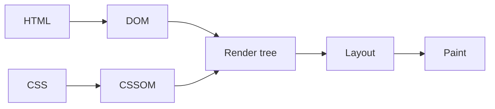

# 🧭 Concepts worth exploring

The original PDF ends with a list of **"what to learn next"** topics for each chapter. It only *names* them. This page gives each one a friendly first introduction (what it is, why you'd care, and a tiny example) so you know what you're looking for when you go deeper.

> ➕ **Addition:** everything below is my own explanation of the PDF's topic list. The JavaScript and Node snippets were run on Node 22 to check the outputs shown. The HTML and CSS snippets are standard and weren't run here.

**Jump to:** [HTML](#chapter-1--html) · [CSS](#chapter-2--css) · [JavaScript](#chapter-3--javascript) · [Node.js, Express & REST](#chapter-4--nodejs-express--rest)

---

## Chapter 1 · HTML

### 1. HTML validation ✅
**What:** Checking that your HTML follows the rules, using a tool called a *validator*. **Why:** Browsers silently repair mistakes ([Lesson 3](../01-html/03-nesting.md) showed this), so bugs hide. A validator tells you about them. **Try:** paste your page into the W3C Markup Validator (link in [Useful links](useful-links.md)) and fix what it reports.

### 2. Web Components 🧩
**What:** A browser feature for making your **own custom HTML tags**, like `<workshop-card>`, with their own look and behaviour, reusable anywhere. **Why:** Reuse without a framework. **Taste of it:**
```js
class WorkshopCard extends HTMLElement {
  connectedCallback() { this.innerHTML = `<article>${this.getAttribute('title')}</article>`; }
}
customElements.define('workshop-card', WorkshopCard);
// then in HTML:  <workshop-card title="Intro to AWS"></workshop-card>
```
(Custom tag names must contain a hyphen.)

### 3. ARIA in depth ♿
**What:** **ARIA** attributes (`role`, `aria-label`, `aria-expanded`…) add accessibility information when plain HTML can't express it, e.g. a custom dropdown built from `<div>`s. **Golden rule:** *use a real HTML element first* (`<button>`, `<nav>`); reach for ARIA only when no native element does the job. You already used one: `role="alert"` in the [JS extras](../03-javascript/14-capstone-bring-the-page-to-life.md) makes screen readers announce the error message.

### 4. How a browser turns HTML into the DOM and renders it 🏭
**What:** The browser's pipeline: it **downloads** the HTML, **parses** it into the DOM tree, parses CSS into a second tree (the CSSOM), combines them into a **render tree**, works out **layout** (sizes and positions), then **paints** pixels. **Why it matters:** it explains why `defer` matters, why scripts can block the page, and why changing layout is more expensive than changing a colour.



### 5. Advanced HTML APIs 🛰️
**What:** Browser features you reach through JavaScript but that are part of the web platform: `localStorage`, the **Geolocation** API, **Drag and Drop**, the **Canvas** for drawing, **Web Workers** for background work, and more. **Tip:** search MDN for "Web APIs" to see the full menu.

---

## Chapter 2 · CSS

### 1. CSS custom properties (variables) 🎛️
Store a value once and reuse it. Change it in one place and the whole site updates.
```css
:root { --blue: #1f5fbf; }
a { color: var(--blue); }
button { background-color: var(--blue); }
```
Worked answer in the [CSS capstone](../02-css/10-capstone-style-the-page.md).

### 2. Transitions and animations 🎞️
A **transition** smoothly changes a property when something happens (like hover). An **animation** (`@keyframes`) can run on its own.
```css
button { transition: background-color 0.2s ease; }
button:hover { background-color: #174a94; }

@keyframes pulse { from { transform: scale(1); } to { transform: scale(1.05); } }
.badge { animation: pulse 1s ease-in-out infinite alternate; }
```

### 3. Pseudo-elements (`::before` and `::after`) ✨
Extra "virtual" elements CSS can add before or after an element's content, without touching the HTML. (Not to be confused with *pseudo-classes* like `:hover`, which have **one** colon.)
```css
.featured::before { content: "★ "; color: gold; }
```

### 4. Fluid sizing with `clamp()` 📏
`clamp(min, preferred, max)` lets a size grow with the screen but never go below or above limits.
```css
h1 { font-size: clamp(1.5rem, 4vw, 2.5rem); }
```
Read it as: "4% of the viewport width, but at least 1.5rem and at most 2.5rem."

### 5. Dark mode and `prefers-color-scheme` 🌙
Respond to the visitor's operating-system setting. Pairs beautifully with custom properties.
```css
@media (prefers-color-scheme: dark) {
  :root { --text: #e5e7eb; --page-bg: #111827; }
}
```

### 6. Responsive grids with `auto-fit` and `minmax()` 🧱
A grid that chooses its own number of columns, with **no media queries**:
```css
.workshop-grid { display: grid; gap: 1rem; grid-template-columns: repeat(auto-fit, minmax(16rem, 1fr)); }
```
"Fit as many columns as you can, each at least 16rem wide, sharing leftover space equally."

### 7. Container queries and the `:has()` selector 📦
- **Container queries** let a component respond to the size of *its container* instead of the whole window, so a card can restyle itself wherever it's placed (`@container (min-width: 30rem) { … }`).
- **`:has()`** is the long-awaited **parent selector**: `article:has(img) { … }` styles an article *that contains* an image.

### 8. Accessibility: focus styles and `prefers-reduced-motion` ♿
- **Focus styles:** always keep a clearly visible outline for keyboard users (see the focus-colour contrast note in the [CSS capstone](../02-css/10-capstone-style-the-page.md)).
- **`prefers-reduced-motion`:** some people get dizzy or distracted by animation. Respect their system setting:
```css
@media (prefers-reduced-motion: reduce) {
  * { animation: none !important; transition: none !important; }
}
```

### 9. CSS frameworks (Bootstrap, Tailwind CSS) and preprocessors (Sass) 🧰
- **Frameworks** give you ready-made styles: **Bootstrap** supplies finished components (buttons, navbars); **Tailwind CSS** gives you tiny utility classes (`p-4`, `text-center`) to compose your design in the HTML.
- **Sass** is a *preprocessor*: a language that compiles into CSS and adds conveniences (variables, nesting, reusable chunks).

Learn plain CSS first. Then every framework will make sense, because they are all CSS underneath.

---

## Chapter 3 · JavaScript

### 1. Destructuring and the spread operator (`...`) 🎁
**Destructuring** unpacks values into variables; **spread** copies or merges objects and arrays.
```js
const workshop = { name: "AWS", date: "12 Oct", level: "Beginner" };
const { name, level } = workshop;              // name = "AWS", level = "Beginner"
const [first, ...rest] = ["a", "b", "c"];      // first = "a", rest = ["b", "c"]
const copy = { ...workshop, level: "Advanced" };  // a NEW object; the original is unchanged
console.log([...[1, 2], ...[3]]);              // [ 1, 2, 3 ]
```
Spread is the standard way to copy an object or array without sharing a reference (remember [Common mistake #8](../03-javascript/common-mistakes.md)).

### 2. Promises: what `async/await` is built on 🤝
A **Promise** is an object representing "a value that will exist later". `await` is a friendlier way of waiting for one. `Promise.all` runs several things **in parallel** and waits for all of them:
```js
const [users, posts] = await Promise.all([
  fetch('/users').then(r => r.json()),
  fetch('/posts').then(r => r.json())
]);
```
I measured it: two 100 ms waits run via `Promise.all` finish in about 105 ms total, not 200.

### 3. Closures and `this` 🔒
A **closure** is a function that *remembers* the variables around where it was created:
```js
function counter() {
  let n = 0;
  return () => ++n;      // remembers n
}
const c = counter();
c(); c();
console.log(c());        // 3
```
`this` is explained at the end of [JS Lesson 8](../03-javascript/08-functions.md): regular functions get their own `this`; arrow functions borrow it from the surrounding code.

### 4. The event loop 🔄
Why doesn't `await fetch(...)` freeze the page? JavaScript runs **one thing at a time**, but hands slow jobs (timers, network) to the browser and picks up their results later, from queues, whenever it's free. Run this to see the order:
```js
console.log("1 sync");
setTimeout(() => console.log("4 timeout 0"), 0);
Promise.resolve().then(() => console.log("3 microtask"));
console.log("2 sync");
// 1 sync, 2 sync, 3 microtask, 4 timeout 0
```
Even a 0 ms timeout waits until the current code finishes, and promise callbacks ("microtasks") go before timers.

### 5. Optional chaining (`?.`) and nullish coalescing (`??`) 🛟
`?.` safely reaches into something that might be `null`/`undefined`; `??` supplies a fallback for only `null`/`undefined`:
```js
const user = { profile: null };
console.log(user.profile?.email);              // undefined (no crash!)
console.log(user.profile?.email ?? "no email");  // no email
console.log(0 ?? 5, 0 || 5);                   // 0 5  — ?? keeps the 0, || replaces it
```
You already met `??` in the Tasks API's PUT route.

### 6. ES modules: `import` and `export` 📦
The browser/modern-Node way to split code across files (compare Node's older `require`):
```js
// math.mjs
export const add = (a, b) => a + b;
export default function hi() { return "hi"; }

// app.mjs
import hi, { add } from "./math.mjs";
console.log(hi(), add(2, 3));   // hi 5
```
In a page you load it with `<script type="module" src="app.js">`.

### 7. Classes and class syntax 🏛️
A tidier way to create many similar objects with shared methods:
```js
class Workshop {
  constructor(name) { this.name = name; }
  describe() { return `Workshop: ${this.name}`; }
}
console.log(new Workshop("AWS").describe());   // Workshop: AWS
```

### 8. Debouncing and throttling ⏱️
For events that fire constantly (`input`, `scroll`). **Debounce** = "wait until the user *stops* for a moment, then run once." **Throttle** = "run at most once every N ms."
```js
function debounce(fn, ms) {
  let timer;
  return (...args) => { clearTimeout(timer); timer = setTimeout(() => fn(...args), ms); };
}
const search = debounce(text => console.log("searching:", text), 300);
// typing "a", "ab", "abc" quickly calls search 3 times but it only runs once, with "abc"
```
(Note the closure from topic 3 doing the remembering.)

### 9. Local storage and session storage 💾
Tiny key-value stores built into the browser. `localStorage` survives closing the browser; `sessionStorage` lasts only for the tab. They store **strings only**, so combine with `JSON`:
```js
localStorage.setItem('name', 'Sara');
console.log(localStorage.getItem('name'));      // Sara
localStorage.setItem('prefs', JSON.stringify({ dark: true }));
const prefs = JSON.parse(localStorage.getItem('prefs'));
```
They live in the browser, not Node, so they're not for secrets, and users can edit them.

---

## Chapter 4 · Node.js, Express & REST

### 1. Promises and `async/await` in more depth ⚙️
Same ideas as JS topic 2, now on the server: e.g. several database queries at once with `Promise.all`, plus careful `try...catch` so one failing task doesn't crash the server.

### 2. Environment variables and `.env` files 🔐
Keep secrets and settings **out of the code** (and out of version control). Put them in a `.env` file:
```
PORT=3000
MONGO_URL=mongodb://127.0.0.1:27017/schoolApp
```
Modern Node can load it directly: `node --env-file=.env server.js`, then use `process.env.PORT`. (I tested this on Node 22: `process.env.GREETING` printed the value from the file.) Add `.env` to `.gitignore`: this repo's does.

### 3. The MVC pattern 🏗️
A way to organise a growing project: **M**odels (data: like `models/User.js`), **V**iews (what the user sees), **C**ontrollers (the logic that connects them). You've already started: the signup example separates the model into its own file.

### 4. Authentication 🪪
Proving **who a user is**. Typically with **sessions** (the server remembers you, and gives your browser a cookie) or **JWTs** (JSON Web Tokens: a signed token the client sends with each request). Never store plain-text passwords: hash them (e.g. with bcrypt).

### 5. Middleware 🚦
Functions that run **between** a request arriving and its route handler: logging, authentication, parsing. You've used one already: `express.json()`.
```js
app.use((req, res, next) => {
  console.log(req.method, req.url);   // runs for every request
  next();                             // pass control on to the next step
});
```
Forget `next()` and the request hangs, the same symptom as Common mistake #2.

### 6. CORS (Cross-Origin Resource Sharing) 🚧
The browser rule that blocks a page from calling an API on a **different origin** (different address *or port*) unless the server explicitly allows it. It shows up the moment your frontend (say, Live Server on port 5500) calls your backend (port 3000). The fix lives on the **server**: the `cors` npm package (`app.use(cors())`) or serving both from the same server, as in topic 7.

### 7. `express.static()` 🗂️
Serve a whole HTML/CSS/JS frontend straight from your Express server:
```js
app.use(express.static('public'));   // files in /public are now served at /
```
That's exactly how the [signup example](../04-nodejs-express-rest/examples/07-signup-mongodb/server.js) avoids CORS.

### 8. Validating request data ✔️
Never trust incoming data. Check that `req.body.title` exists *before* creating or updating anything, and return `400 Bad Request` if not:
```js
if (!req.body.title) return res.status(400).json({ error: 'title is required' });
```
Mongoose can validate too: `name: { type: String, required: true }`, `email: { type: String, unique: true }`.

### 9. Automated testing of an API 🤖
Instead of re-checking by hand with Postman or curl, write tests that do it for you: **Jest** (test runner) with **Supertest** (sends requests to your app). A test reads like: "when I `GET /tasks`, expect status 200 and an array."

### 10. Deploying a Node.js app 🚀
Making it reachable outside your own computer, e.g. on **Render**, **Railway**, or a **VPS** (a rented server you manage yourself). Platforms typically want a `start` script in `package.json` (the examples here have one) and read the port from an environment variable (`process.env.PORT`).

---

⬅️ [Back to the main README](../README.md)
